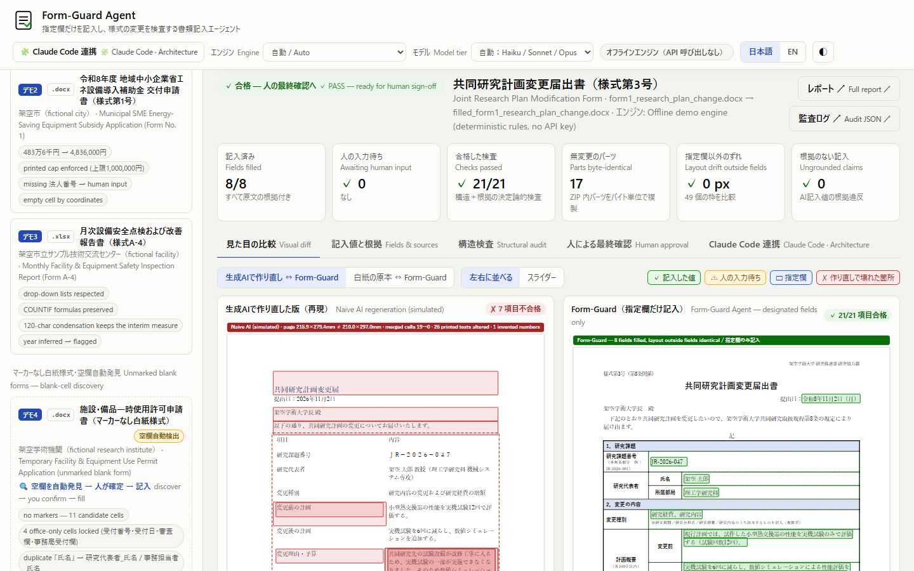
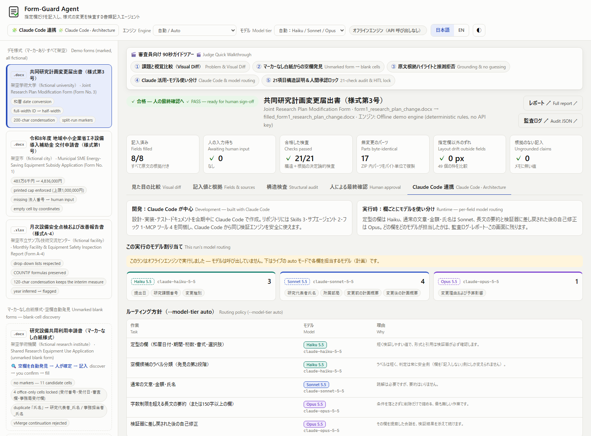
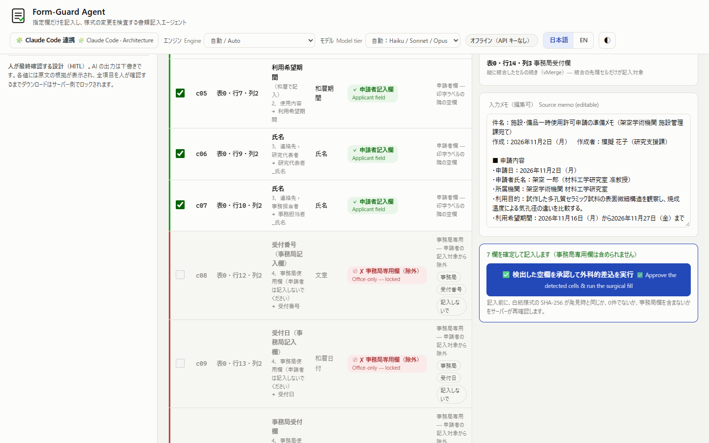

# Form-Guard Agent

**Fill only the designated fields of a Word / Excel / fixed PDF form, prove that nothing else changed, and keep a human in the loop.**
**指定欄だけを記入し、様式の変更を検査する書類記入エージェント**

Built for **Built with Claude: Japan 2026** (development started Monday, 2026-11-02 / 2026-11-02（月）). [日本語版はこちら ↓](#日本語) · [How Claude & Claude Code are used ↓](#claude-usage) · [3分デモ動画の台本 / Demo video script (JA)](docs/DEMO_VIDEO_SCRIPT_JA.md)



### ⚡ 30-Second Judge Quick Reference / 審査員向け 30秒早見表（4つの審査基準と確認リンク）

※下の `#tour=1`〜`#tour=5`・`/portal` は、`python -m form_guard.cli --serve` でローカルサーバー（`http://127.0.0.1:8000`）を起動した状態で1クリックで開けます（ローカルサーバー起動前にGitHub上でそのまま確認できるスクリーンショット・ドキュメントへの直リンクも併記しています）。

| 審査基準 / Judging Criterion | 配点 | 何を確認できるか / What Form-Guard Proves | Web UI ガイドツアー & 実証リンク |
|---|---|---|---|
| **① インパクト（潜在的インパクト）**<br>Potential Impact | **30%** | 行政・大学・施設の指定様式（`.docx` / `.xlsx` / 固定 `.pdf`）で、罫線1本・結合セル1つの崩れによる差し戻し（押印・決裁の取り直しや再提出の手戻り）を防ぎ、非エンジニアでもWeb画面で各値の原文根拠を確かめてから承認できる（導入はPython 3.10以上・APIキー無しでも全工程が動く） | [トップ画面 `/` 上部バナー](http://127.0.0.1:8000/)（[スクショ1](docs/screenshots/01_visual_diff.png)） · [ハッカソン後の継続利用場面 ↓](#why-this-matters--who-keeps-using-it-after-the-hackathon) |
| **② デモ（デモの完成度）**<br>Demo & Presentation | **25%** | 作り直し版（失敗再現データ・7項目不合格）との視覚比較、マーカーなし白紙からの4段階空欄自動発見、原文引用ハイライトと推測拒否（法人番号は人の入力待ち） | [`/#tour=1`（視覚比較）](http://127.0.0.1:8000/#tour=1)（[スクショ1](docs/screenshots/01_visual_diff.png)） · [`/#tour=2`（空欄自動発見）](http://127.0.0.1:8000/#tour=2)（[スクショ6](docs/screenshots/06_unmarked_discovery.png)） · [`/#tour=3`（原文根拠・推測拒否）](http://127.0.0.1:8000/#tour=3)（[スクショ2](docs/screenshots/02_fields_and_sources.png)） · [3分動画台本](docs/DEMO_VIDEO_SCRIPT_JA.md) |
| **③ Claudeの活用（Claude Code中心の開発・使い分け）**<br>Creative Use of Claude | **25%** | 欄ごとの3段モデル振り分け（Haiku 4.5 / Sonnet 5 / Opus 5.5・実API疎通確認済み）＋404フォールバック連鎖、2段フック（`PreToolUse` / `PostToolUse`）、`Edit`/`Write`ツール無しの4サブエージェント（うち3種はフック付き`Bash`を使用）、Skills 6種、依存ゼロの5ツール MCP、公募ポータル [`/portal`](http://127.0.0.1:8000/portal) 連携 | [`/#tour=4`（「Claude Code 連携 · Architecture」タブ）](http://127.0.0.1:8000/#tour=4)（[スクショ7](docs/screenshots/07_claude_code_architecture.png)） · [BUILT_WITH_CLAUDE_CODE.md](docs/BUILT_WITH_CLAUDE_CODE.md) |
| **④ 深さと実行力（実装の深さと実行力）**<br>Depth & Execution | **20%** | 7区分21項目＋`VIS-01`（指定欄以外のずれ `0 px`）の決定論的検査、版（`revision`）と `SHA-256` に結び付いた人間承認ロック、実機 Word/Excel 16.0・実API 3階層ルーティング検証、272件の自動テスト（APIキー不要で再現可） | [`/#tour=5`（21項目構造証明＆人間承認ロック）](http://127.0.0.1:8000/#tour=5)（[スクショ3](docs/screenshots/03_structural_audit.png)・[スクショ4](docs/screenshots/04_human_approval.png)） · [試行錯誤の記録](docs/BUILT_WITH_CLAUDE_CODE.md#5-iterating-with-claude-code) · [実機検証記録](#verified-on-real-machines-2026-11-03火) · [自動テスト (`tests/test_form_guard.py`)](tests/test_form_guard.py) |

---

## Why this matters & Who keeps using it after the hackathon

**Concrete pain in Japan's workplaces.**
- University and research-institute administration (共同研究の計画変更届, 研究設備の利用申請), municipal subsidy and disaster-stockpile counters (補助金の交付申請, 備蓄品の貸出申請) and facility safety inspections (月次点検報告) all run on official `.docx` / `.xlsx` templates with strict cell grids, merged cells, `vMerge`, formulas, drop-down lists and printed legal boilerplate.
- One broken border, one paraphrased clause or one number the notes never stated can lead to administrative rejection (差し戻し) and another round trip — requiring internal approvals or seals to be re-obtained and the document to be re-submitted.
- The people who fill these forms every month — research administrators, municipal applicants and back-office staff, mostly not engineers — cannot safely use chat AI for it: asked to "fill in this form", it typically **re-creates the document**, and a re-created document can split merged cells, lose borders, paraphrase legal text, change the page setup and add numbers that are in nobody's notes — and nobody can tell what changed.

- **Theme 1 — depth only someone from the domain sees:** the dangerous failure is not "the AI wrote a wrong
  sentence" but "the AI silently changed the form". Form-Guard checks the form itself (ZIP, XML skeleton, borders,
  merges, boilerplate) and refuses to guess facts (`法人番号` stays empty for the human).
- **Theme 2 — what should reach everyone:** non-engineers get AI help without having to trust it: every value shows
  its verbatim source, office-only cells are locked, and the download stays locked until a named person signs off.

**Measured quantitative proof** (`python docs/measure_workflow.py` — offline engine, fictional sample forms; the
left-hand columns are counted from the files, **not** a timed study of a person):

| Form | Fields to set up by hand | Characters to transcribe | Printed elements to re-check line by line | Form-Guard wall-clock (measured) | Automated checks | Left for human sign-off |
|---|---|---|---|---|---|---|
| form1 `form1_research_plan_change.docx` | 8 (markers / coordinates already designated) | 325 | 492 XML tags · 35 printed text blocks · 19 merged cells/ranges · 9 border definitions · 18 package parts | 189 ms | 21/21 (PASS) | 10 checklist items |
| form2 `form2_municipal_equipment_subsidy.docx` | 11 (markers / coordinates already designated) | 174 | 519 XML tags · 34 printed text blocks · 7 merged cells/ranges · 12 border definitions · 18 package parts | 183 ms | 21/21 (NEEDS_HUMAN_INPUT) | 13 checklist items, 1 field(s) to enter |
| form3 `form3_facility_safety_inspection.xlsx` | 10 (markers / coordinates already designated) | 184 | 323 XML tags · 34 printed text blocks · 40 merged cells/ranges · 350 border definitions · 9 package parts | 246 ms | 21/21 (PASS) | 12 checklist items |
| form4 `form4_unmarked_blank.docx` | 7 (locate 11 empty cells, decide office vs applicant) | 113 | 503 XML tags · 38 printed text blocks · 24 merged cells/ranges · 10 border definitions · 18 package parts | 120 ms | 21/21 (PASS) | 9 checklist items |
| form5 `form5_unmarked_blank.xlsx` | 5 (locate 6 empty cells, decide office vs applicant) | 52 | 282 XML tags · 30 printed text blocks · 34 merged cells/ranges · 269 border definitions · 9 package parts | 154 ms | 21/21 (PASS) | 7 checklist items |

- Across the 5 built-in Word/Excel forms (form1–form5; the fixed-PDF demo 6 is not in this table, 41 designated fields in total), Form-Guard filled 40 fields (848 characters written), leaving 1 unstated field for human input, and verified 2,119 XML tags, 171 printed text blocks, 124 merged cells/ranges and 650 border definitions in under 0.4 s per form (120–246 ms in the table above; 119–379 ms in the web suite measurement; wall-clock varies with PC load).
- On the 6th built-in demo (`form6_study_group_grant.pdf`, A4 fixed PDF), Form-Guard reconstructs 19 ruled boxes across 2 tables, recommends 7 applicant boxes (including `□ 合意済み → ■ 合意済み` and `税込で48万円 → 480,000円`), locks 2 office-only boxes, appends a PDF incremental update keeping the 3,742-byte blank PDF as an exact byte prefix, and passes all 21/21 checks with `0 px` pixel diff outside the designated boxes.
- What is left for the person is the 51-item source-linked sign-off checklist (plus 9 items on form6) and 1 unstated fact — `法人番号` in form2 — which stays empty for the human instead of being hallucinated.

**Post-hackathon continued use & deployment roadmap**

- **1. Daily administrative paperwork via the web UI / CLI.** Research administrators, municipal applicants and
  back-office staff register their recurring `.docx` / `.xlsx` templates once (unmarked forms: the web UI's
  blank-cell discovery or `--discover-blanks`, then a person confirms the cells) and fill monthly / quarterly reports
  from meeting notes — with zero template drift proven on every run and an auditable trail (`approval.json`,
  `audit_log.json`, `report.html`). It runs locally on `127.0.0.1` and works offline without an API key.
- **2. Direct integration into Claude Code workflows via `.mcp.json` and Skills.** Clone this repository, install it
  (`python -m venv .venv`, then `pip install -r requirements.txt`) and launch Claude Code from the repository root —
  or point `.mcp.json` and `.claude/settings.json` at that installed environment and at `scripts/hook_guard.py`
  (copying only `.mcp.json` and `.claude/` into a document folder is not enough: they run this repository's code).
  The assistant then fills forms through Form-Guard's tools, gets **unapproved drafts** back, and MCP intentionally omits an
  approval tool — final sign-off is performed by a reviewer in the web app (which verifies the reviewer name, checked items, `revision` and `filled_sha256`). Other MCP clients (e.g. Claude Desktop) can
  register the same server command, `python -m form_guard.mcp_server`.

## What Form-Guard does

```
 blank form (.docx/.xlsx) + free-text memo
        |
 1 Scan ............ find {{markers}} / [記入欄: …] / coordinate-designated empty cells (Word table cells and
        |            Excel cells), read the rules printed on the form (200字以内, 和暦, 13桁, 上限1,000,000円,
        |            drop-down lists, deadlines between two dates such as 「変更予定日の30日前までに提出」); an
        |            UNMARKED blank form gets a 4-stage blank-cell discovery instead (applicant vs office-only
        |            cells) and a human confirms the cells to fill
 2 Map & self-correct  Claude (live, Haiku / Sonnet / Opus routed per field) or a deterministic offline engine
        |            proposes a value + VERBATIM memo quotes; an independent validator checks quotes, numbers,
        |            dates (real calendar date, era, weekday), names, IDs, options and printed rules; failures are
        |            repaired (和暦 with weekday, 483万6千円 → 4,836,000円, half-width IDs, deletion-only
        |            condensation that never silently drops a condition, interim measure, decision or weekday) or
        |            sent back to Claude (Opus) with the validator's findings
 3 Surgical write .... replace ONLY the marker characters inside the XML bytes; every other ZIP entry is copied
        |            as raw compressed bytes (not even re-compressed)
 4 Verify ............ 21 deterministic checks (plus VIS-01 if layout drift or overflow is detected): ZIP/SHA-256,
        |            XML skeleton, tables/borders/merges, boilerplate text, grounding, constraints, application load
 5 Human sign-off .... checklist with the source quote for every value (and the full text of anything condensed
                     away); any field can be corrected; the download unlocks only after a named reviewer confirms
                     every item (enforced by the server, bound to the revision on screen and the file's SHA-256)
```

Anything Form-Guard cannot ground in the memo is **never guessed**: it is left for the reviewer
(see 法人番号 in demo 2).

## Quick start (no API key needed)

```bash
python -m venv .venv
.venv\Scripts\activate            # Windows cmd  (PowerShell: .venv\Scripts\Activate.ps1 · macOS/Linux: source .venv/bin/activate)
pip install -r requirements.txt

python -m form_guard.cli --all-demos     # runs the 3 marked fictional demos -> output/index.html
python -m form_guard.cli --serve         # web UI on http://127.0.0.1:8000 (all 6 demos + grant portal: /portal)
pytest -v                                # 272 tests
```

Requires Python 3.10+. Without `ANTHROPIC_API_KEY` everything runs on the deterministic **offline demo engine**, so the
whole pipeline is reproducible with zero setup.

**Using the repository's Claude Code setup:**
- Clone the repository, run the install steps above, and start Claude Code from the repository root, in the shell in which `.venv` is activated (to work from another folder, point `.mcp.json` and `.claude/settings.json` at this environment and at `scripts/hook_guard.py`).
- The project hooks run `python scripts/hook_guard.py …` and `.mcp.json` runs `python -m form_guard.mcp_server`, so `python` must be on `PATH`. The hook script needs only the standard library (any Python 3.9+), and its import check always prefers `.venv` (override: `FORM_GUARD_HOOK_PYTHON`); the MCP server re-launches itself with `.venv` when the `python` on `PATH` lacks the dependencies.
- If no `python` is found, Claude Code shows a non-blocking hook error — activate `.venv` (or put Python on `PATH`) and restart Claude Code.

The web UI is Japanese first (`日本語 / EN` toggle in the top bar):
- The **🎬 審査員向け 90秒ガイドツアー / Judge Quick Walkthrough** bar jumps straight to the five proof points: ① visual diff against a naive regeneration, ② blank-cell discovery on an unmarked form, ③ verbatim grounding and no guessing (`483万6千円 → 4,836,000円`, the printed cap, the missing `法人番号`), ④ Claude usage — per-field model routing and the Claude Code suite, ⑤ the 21-check audit and the human approval lock. A **なぜ Form-Guard か？（解決する現場課題）** banner at the top states the problem in three lines.
- The left rail lists all six demos: **デモ1–デモ5** (Word / Excel) and **デモ6**, a fixed PDF (badge **固定PDF・空欄自動検出**, see [Fixed PDF forms](#fixed-pdf-forms-phase-4)) — three marked forms and the two **unmarked blank forms** — デモ4 (form4 `.docx`) and デモ5 (form5 `.xlsx`), badged **空欄自動検出**.
- One click on デモ4 / デモ5 runs the 4-stage blank-cell discovery *and* an auto-preview fill of the recommended applicant cells, so the discovery table and the filled result are on screen together; **✅ 検出した空欄を承認して外科的差込を実行** turns the reviewer's own selection into the run that can be signed off (the auto-preview itself can never be approved). An uploaded form without markers goes to discovery automatically, and **🔍 Discover blank cells** is there for your own unmarked forms.
- Each field in Fields & sources carries a model-tier badge (`Opus 5.5` / `Sonnet 5` / `Haiku 4.5`, or `Offline Rule` plus the live plan). Deep links for recordings: `/#tour=1` … `/#tour=5`, `/#demo=form4` (or `/#unmarked=form4`), `/#pdf=form6`, `/#demo=form2&tab=hitl`, `/#view=claude`, `/#lang=en`, and the grant portal `/portal` (top bar: **🌐 公募様式ポータル (/portal)**). The 3-minute demo video (Japanese narration, 175 s) walks through these deep links step by step: [docs/DEMO_VIDEO_SCRIPT_JA.md](docs/DEMO_VIDEO_SCRIPT_JA.md).

## Live Claude mode

Set the key in your shell or in a git-ignored `.env` file in the project root:

| Variable | Default | Meaning |
|---|---|---|
| `ANTHROPIC_API_KEY` | – | enables live mode (`--mode auto` picks it up) |
| `FORM_GUARD_MODEL_TIER` | `auto` | `auto` routes per field (below); `opus` / `sonnet` / `haiku` use one model (CLI: `--model-tier`) |
| `FORM_GUARD_MODEL_TIERING` | – | `auto` / `off` — the same switch as `--model-tiering` (`off` = one model, Opus, for every call) |
| `FORM_GUARD_MODEL` | – | pins one model id for every call (CLI: `--model`) |
| `FORM_GUARD_EFFORT` | `medium` | `output_config.effort` (`low` … `max`; clamped to what the model supports) |
| `FORM_GUARD_FALLBACKS` | `1` | server-side refusal fallback opt-in (only where the model supports it); set `0` to disable |

```bash
python -m form_guard.cli --all-demos --mode live
python -m form_guard.cli --form my_form.docx --memo notes.txt --out-dir out --mode live --model-tier auto
python -m form_guard.cli --form my_form.docx --memo notes.txt --out-dir out --mode live --model-tiering off
```

How Claude is used at runtime (`form_guard/mapper.py`):

- **Multi-model routing** (`--model-tier auto`): structured fields (和暦 dates, periods, digits, ID patterns,
  choices) and blank-cell label classification → `claude-haiku-4-5-20251001`; standard text, yen amounts and names →
  `claude-sonnet-5`; long-text condensation and every self-correction pass after a validator rejection →
  `claude-opus-5-5`. The audit log and the report show which model handled which field and why.
- **Escalation**: a Haiku or Sonnet draft that fails grounding or a printed rule is re-done by `claude-opus-5-5` with
  adaptive thinking, in the conversation that proposed it; every escalation is recorded in `usage.escalations`
  (field, from → to, the verifier's reason). `--model-tiering off` (or a fixed `--model-tier`) uses one model instead.
- **Model availability fallback** (`MODEL_FALLBACK_CHAIN`): if the API answers `404 not_found_error` for a tier's model
  id on your API organisation, the call is retried along `claude-opus-5-5` → `claude-opus-5` → `claude-opus-4-6`,
  `claude-sonnet-5` → `claude-sonnet-4-5`, `claude-haiku-4-5-20251001` → `claude-haiku-4-5`. The first id that
  answers serves the rest of the run, the request is rebuilt from that model's
  capabilities (no thinking or effort for a legacy id), and `audit_log.json` keeps the requested tier model
  next to the served id (`usage.model_fallbacks`, `usage.calls[].attempted_models`, the `routed_model` note).
- **Every field records its model**: each mapping carries `routed_model` / `route_reason` — the id the API actually
  served (`claude-haiku-4-5-20251001`, or `claude-sonnet-5 → claude-opus-5-5 (revision)` after a self-correction; a
  server-side fallback to another model shows up as such). Offline runs show the plan live auto mode would follow —
  `offline (claude-haiku-4-5-20251001 in live auto)` — and their routing groups are marked `planned_in_live_auto`, so a plan is
  never mistaken for a call. The web UI shows the routing per field (Fields & sources, with any API-returned thinking
  summary) and per run (tab **Claude Code 連携 · Architecture**); the top-bar **Model tier** selector
  (`Auto: Haiku 4.5 / Sonnet 5 / Opus 5.5`, `Opus 5.5 only`, `Sonnet 5 only`, `Haiku 4.5 only`) is sent with every run.
- **Structured outputs** (`output_config.format` = JSON schema): one entry per field with `value`,
  `source_quotes` (verbatim, single-line), line numbers, confidence and a short reason — or `not_found`.
- **Adaptive thinking** (`display: "summarized"`) with an explicit **effort** level, streamed with
  `get_final_message()`. Request parameters are adapted per model via `model_capabilities()` — an explicit table of
  known model ids (`opus` / `sonnet` / `haiku` 4.5, 4.6, 4.7, 5, 5.5 and `fable` 5 / 5.1): legacy models such as
  `claude-haiku-4-5` — the Haiku tier `claude-haiku-4-5-20251001` included — get plain structured-output requests,
  and an unrecognised family or version gets no capability flags at all.
  Request formatting is verified against mock/transport tests; live API availability and model-specific features
  depend on the caller's Anthropic account tier. On 2026-11-03（火）, a live 3-tier API run was also verified in
  `output/live_smoke_form1/audit_log.json` (run `20261103-164113-f83bad`, local git-ignored `output/` directory). Thinking summaries returned by the API are kept in the audit log,
  labelled as API-returned summaries.
- **Self-correction loop**: the validator's findings ("quote not found verbatim", "212 chars exceeds the 200-char
  limit", "1,612,000円 exceeds the printed cap") are sent back in the same conversation; only the failing fields
  are revised. Values that still fail are *not* written; they go to the reviewer.
- **Refusals** are handled (`stop_reason == "refusal"`), with the server-side fallback opt-in
  (`fallbacks="default"`, beta `server-side-fallback-2026-07-01`). In `auto` mode, a failed live call falls back
  to the offline engine and the report says so — including the API calls and tokens used before the failure
  (`usage.live_attempt_failed`), never "no model was called".
- The memo is treated as data, never as instructions (prompt-injection guard in the system prompt).

The whole project — code, tests, sample generators and docs — was written with **Claude Code** during the hackathon.

## Claude Code integration: skills, subagents, hooks, MCP

The repository ships its own Claude Code setup (details and rationale: [docs/BUILT_WITH_CLAUDE_CODE.md](docs/BUILT_WITH_CLAUDE_CODE.md)):

| | |
|---|---|
| `.claude/skills/` | `form-scan`, `surgical-fill`, `structural-audit`, `form-fill-verify`, `visual-diff-audit`, `portal-form-fill` — scan (with blank-cell discovery) → fill → audit, a one-pass fill-and-verify, the visual / layout audit, and the one-sentence grant-portal workflow (portal → discover → fill → verify → sign-off page in Chrome) |
| `.claude/agents/` | `memo-extractor` (Sonnet: blind verbatim extraction *before* it sees the slots), `field-mapper` (`claude-opus-5-5`: rule-aware proposals — 和暦, caps, condensation), `structure-auditor` (Sonnet: fast deterministic audit), `form-auditor` (Opus: adversarial re-verification and the HITL list). **No file-editing tools (`Edit`/`Write`)**: `memo-extractor` uses only `Read, Grep, Glob`, and `form-auditor` (like `field-mapper` and `structure-auditor`) uses `Read, Grep, Glob, Bash` for verification commands under `PreToolUse` protection. That `Bash` is limited by the agents' prompt instructions and by the `PreToolUse` hook (`scripts/hook_guard.py`), which blocks any write, move or deletion targeting `samples/blank_forms/` — the tool list alone does not make a shell read-only |
| `.claude/settings.json` + `scripts/hook_guard.py` | **Two-stage hook guard.**<br>• `PreToolUse` (`Write`, `Edit`, `MultiEdit`, `NotebookEdit`, `Bash`, `PowerShell`) prevents *before anything is written* — exit code 2 + `permissionDecision: "deny"` — any write, copy-over, move or delete of `samples/blank_forms/*.docx` / `*.xlsx` / `*.pdf` — the folder itself, folders above it and wildcards included (`rm -rf samples/blank_forms`, `Remove-Item -LiteralPath samples/blank_forms -Recurse`, `rm samples/blank_forms/*`); only the real generator command `python -m form_guard.cli --generate-samples` is exempt, never a flag inside a `# comment` — and any write that would put an Anthropic API key, a literal `ANTHROPIC_API_KEY = "sk-…"`, a personal user-profile path (`C:\Users\<user>`, `/Users/<user>`, `/home/<user>` — any user name, Japanese ones included; placeholders such as `<user>`, `runner` or `root` are fine) or an e-mail address outside `example.com` / `example.jp` / `example.org` (and their subdomains) and `users.noreply.github.com` into a project file — the only other address allowed is exactly `noreply@anthropic.com`.<br>• `PostToolUse` (`Write`, `Edit`, `MultiEdit`) verifies *after the write* that Python compiles (`py_compile`) and the edited module imports (< 1.8 s), that JSON parses, and re-scans the file; extensions are compared case-insensitively (`X.PY`, `X.JSON`).<br>• Commands: `python scripts/hook_guard.py pre-tool-use` / `post-tool-use` — no `$`, `%` or backtick, so they run identically in Git Bash, PowerShell, cmd, macOS and Linux (activate `.venv` first, see Quick start) |
| `.mcp.json` | registers the `form-guard` MCP server: `python -m form_guard.mcp_server` (stdio JSON-RPC 2.0, no extra dependencies, UTF-8 forced, messages capped at 10 MB) with `form_guard_list_demos` (all six fictional demos: marked, unmarked and the fixed PDF), `form_guard_scan`, `form_guard_discover_blank_cells`, `form_guard_fill` (writes only an **unapproved draft** into `output/mcp_runs/`, `approval_status: UNAPPROVED_DRAFT_REQUIRES_HUMAN_SIGN_OFF` in the result and in `audit_log.json` — nothing is stamped into the document itself; the result's `review_url` opens that exact draft in the web app for sign-off) and `form_guard_verify` (with VIS-01). `mode` defaults to `demo` (offline); `live` is an explicit opt-in. Paths with a `.env*`, `.git`, `.ssh` or `.claude-hackathon` component are refused |
| Web UI tab **Claude Code 連携 · Architecture** | `GET /api/claude-suite` reads the files above (skills, subagents with their models and tools, both hook stages — `PreToolUse` and `PostToolUse` — with their commands and checks, the permission denials, the MCP tools) and shows how they work together, this run's per-field model routing, the routing policy and the measured workflow numbers |



<a id="claude-usage"></a>
## How Claude & Claude Code Are Used / Claude と Claude Code 機能の目的別使い分け

The core of Form-Guard — turning a free-text memo into field values that can be proven — is done by **Claude at
runtime**; everything that has to be provable is **deterministic code**. Claude Code built the project, and its
project-level setup ships in this repository. Each feature and model was chosen for one job:

| Purpose | Feature / model chosen | Why | Where in repo | How it is verified |
|---|---|---|---|---|
| Map memo facts to form fields (the core of the app) | **Claude** with **structured outputs** (JSON schema) and **adaptive thinking** at an explicit effort level, streamed | value + verbatim quotes + line numbers, or `not_found` — every answer is machine-checkable | `form_guard/mapper.py` (`ClaudeEngine`, `MAPPING_SCHEMA`, `SYSTEM_PROMPT`) | offline: fake client + the real `anthropic` SDK on a mock HTTP transport · live: `--mode live` |
| Spend reasoning where it is needed | **Per-field routing** — `claude-haiku-4-5-20251001` structured fields and label classification · `claude-sonnet-5` standard text, amounts, names · `claude-opus-5-5` long-text condensation and every self-correction; a rejected Haiku / Sonnet draft is **escalated** to Opus | a 13-digit ID needs no deep thinking; a 200-character condensation that must keep every condition does | `route_slot`, `ClaudeEngine.route` / `revise`, `usage.escalations` | offline: the model of every call and the escalation record are asserted; offline runs show the live plan per field |
| Keep working when a model id is unavailable | **Model fallback chain** on `404 not_found_error` | a launching tier id may not be enabled on every API organisation | `MODEL_FALLBACK_CHAIN`, `ClaudeEngine._call` | offline: the real SDK raises `NotFoundError` from a mock transport; requested and served ids are audited |
| Never trust a value without evidence | **Self-correction loop with verbatim-quote grounding** | an LLM answer is a proposal; an independent check decides | `form_guard/grounding.py`, `map_fields` / `repair` | offline: every run of the suite |
| Prove that nothing else changed | **Deterministic verifier** — 21 checks + VIS-01, **0 LLM tokens** | a verdict that must be reproducible never comes from a model | `form_guard/verifier.py`, `form_guard/visual_diff.py` | offline: tampering tests (borders, merges, text, `xml:space`, ZIP, path traversal, XXE) |
| Teach Claude Code this project's workflows | **Skills** (6) | exact commands and guardrails load only when a task matches | `.claude/skills/*/SKILL.md` | offline: valid front matter; every CLI flag a skill names exists |
| Fetch a form from a web portal and hand the result to a person | **Claude in Chrome** + the `portal-form-fill` skill | one sentence → portal page (or `GET /api/portal/forms`) → MCP discover / fill / verify → the `review_url` sign-off page opened in Chrome | `.claude/skills/portal-form-fill/SKILL.md`, `form_guard/portal.py` | offline: portal HTML / JSON / downloads with SHA-256, the MCP → web hand-off of a PDF draft |
| Separate proposing from checking | **Subagents** (4), none with `Edit` / `Write` | the model that proposes values must not be the one that signs off | `.claude/agents/*.md` | offline: tools and models asserted |
| Block configured unsafe actions before writing | **Two-stage hooks** (`PreToolUse` before the write, `PostToolUse` after it) | enforces template & secret guards on configured tools when active (requires Python on `PATH`) | `.claude/settings.json`, `scripts/hook_guard.py` | offline: blocks before the write (exit 2 + deny), post-write checks, a cp932 console |
| Use Form-Guard from any Claude client | **MCP server** (5 tools, stdio, zero dependencies) | Claude Code / Claude Desktop scan, discover, fill and verify as tools and get the human checklist back | `.mcp.json`, `form_guard/mcp_server.py` | offline: JSON-RPC over real stdio, Japanese payloads on a cp932 console, stray prints isolated at the file-descriptor level |

**Offline vs live.**
- Every row is exercised by the pytest suite without an API key: the deterministic parts directly, the Claude parts through a fake client and through the real `anthropic` SDK on a mock HTTP transport (request bodies, streaming, the 404 fallback chain, refusals, escalation).
- A live run with `ANTHROPIC_API_KEY` adds only the models' actual answers and latency — and those answers go through exactly the same validator and verifier.

| 目的 | 選んだ機能・モデル | 選んだ理由 | 検証方法 |
|---|---|---|---|
| メモの事実を様式の欄に対応付ける（中核） | Claude の構造化出力（JSON スキーマ）＋ effort を明示した adaptive thinking | すべての回答が「値＋原文引用＋行番号」か `not_found` で、機械的に検査できる | オフライン：偽クライアントと、実 SDK＋モック通信 ／ ライブ：`--mode live` |
| 推論が必要な所にだけ推論を使う | 欄ごとの振り分け（Haiku：定型欄・ラベル分類／Sonnet：文章・金額・氏名／Opus：長文要約とすべての自己修正）。検証器が却下した Haiku・Sonnet の下書きは Opus に引き上げ | 13桁の番号に深い推論は不要、条件を残す200字要約には必要 | 呼び出しごとのモデルと引き上げ記録をテストで確認 |
| モデル ID が使えない組織でも止まらない | 404 `not_found_error` 時のフォールバック連鎖（`MODEL_FALLBACK_CHAIN`） | 公開直後の ID が全組織で使えるとは限らない | 実 SDK が返す `NotFoundError` で確認。要求モデルと応答モデルを監査ログに記録 |
| 指定欄以外が変わっていないことを証明 | 決定論的な検証器（21項目＋VIS-01、LLM トークン 0） | 再現性が必要な判定をモデルに任せない | 改ざん・パストラバーサル・XXE のテスト |
| 作業手順と「提案役／確認役」の分離 | スキル 6 種、サブエージェント 4 種（どれも `Edit`/`Write` を持たない） | 値を提案したモデル自身に合格を出させない | フロントマターとツール・モデルをテストで確認 |
| Web の公募ポータルから様式を取得し、結果を人に渡す | Claude in Chrome ＋スキル `portal-form-fill` | 一言の依頼 → ポータル（または `GET /api/portal/forms`）→ MCP で発見・記入・検査 → `review_url` の承認画面を Chrome で開く | ポータルの HTML・JSON・SHA-256 付きダウンロード、PDF 下書きの MCP → Web 引き継ぎをテストで確認 |
| 設定した危険な操作を実行前に拒否する | 2 段フック：PreToolUse（書き込み前に阻止）／PostToolUse（書き込み後に検査） | 設定された対象操作（白紙様式の改変や秘密情報の書込み）をフックが検査・拒否（Python環境と設定の有効化が前提） | 書き込み前の阻止（終了コード 2＋deny）、書き込み後の検査、cp932 環境で確認 |
| どの Claude クライアントからでも使う | MCP サーバー（5 ツール・stdio・依存ゼロ） | Claude Code・Claude Desktop からツールとして呼べる | 実 stdio で日本語を含む JSON-RPC を確認 |

すべての行は API キー無しの pytest で検証されています（Claude 部分は偽クライアントと、実 SDK＋モック通信）。ライブ実行で
加わるのはモデルの実際の回答と応答時間だけで、その回答も同じ検証器を通ります。

## Unmarked blank forms: discover → confirm → fill

A form without `{{markers}}` and without a `.slots.json` can still be filled — after a human confirms the cells:

```bash
python -m form_guard.cli --discover-blanks samples/blank_forms/form5_unmarked_blank.xlsx --mode demo --out-dir output
python -m form_guard.cli --form samples/blank_forms/form5_unmarked_blank.xlsx --memo samples/memos/memo5_stockpile_loan.txt \
    --discovery output/form5_unmarked_blank.discovery.json --confirm recommended --out-dir output/form5 --mode demo
```

- **1. Heuristics** — empty cells with a printed label immediately to the left (or above, in a column-header table), and
  date cells printed only with an era-date skeleton such as 「令和　　年　　月　　日」 (offered as `wareki_date`; when
  confirmed, exactly that skeleton is replaced by the date).
- **2. Classification** — applicant field vs office-only (`事務局`, `受付印`, `受付番号`, `審査欄`, `決裁`, `検印` …: never
  recommended); duplicate labels get unique ids (`研究代表者_氏名` / `事務担当者_氏名`); format and character limit are
  inferred from the label. In live mode Claude (Haiku) also classifies the labels, but can only make a cell *less* fillable.
- **3. Safety** — formula cells, merged continuations and cells with any other content are rejected.
- **4. Human gate** — `--confirm c01,c02,…` (or `recommended`) builds the slot spec only if the blank form still has the
  SHA-256 it had at discovery, at least one cell is confirmed, and no office-only cell is included.

**In the web UI:**
- One click on **デモ4** / **デモ5** (badge **空欄自動検出**, under **マーカーなし白紙様式・空欄自動発見 / Unmarked blank forms**) runs discovery and shows the panel **4段階・白紙空欄の自動検出結果（申請者記入欄 vs 事務局専用欄の自動仕分け）**: the blank form's SHA-256, the candidate / recommended / rejected counts, and every candidate cell with its id, location, printed label, inferred format and limit, role and reason.
- Applicant cells (`✓ 申請者記入欄 / Applicant field`) are pre-checked; office-only cells (`✗ 事務局専用欄（除外） / Office-only — locked`) can never be checked. Right under the stages, an **auto-preview** shows the recommended applicant cells already filled — the rendered page, the checks passed, the office-only cells left empty and each value with its model badge — so the result can be inspected in the same click.
- The auto-preview can never be approved: **✅ 検出した空欄を承認して外科的差込を実行** turns the reviewer's selection into the run that continues to the usual visual diff, fields & sources, structural audit and human approval screens. An uploaded form without markers lands here automatically (or press **🔍 Discover blank cells**).

**Web API:**
- `GET /api/demos` lists all six demos (`unmarked: true` for form4 / form5 / form6, `pdf: true` for form6, labels `デモ1`–`デモ6`).
- `POST /api/run-demo` runs any of them in one call — an unmarked demo returns the stored discovery plus the auto-preview run (`auto_preview: true`, refused by `/approve`), and with the reviewer's `discovery_id` + `confirmed_targets` it fills exactly those cells.
- Step by step: `POST /api/discover/demo` (built-in form4 / form5) or `POST /api/discover` (an upload, or a `demo_id`); then `POST /api/runs/from-discovery` (JSON: `discovery_id`, `confirmed_targets` = candidate ids or `"recommended"`, `memo_text`, `mode`, `model_tier`) or `POST /api/runs/upload` (multipart, with `discovery_id` and `confirmed_targets`). `GET /api/unmarked-demos` lists only the two unmarked forms. The discovery stays on the server: the client only names candidate ids, and any other field is refused.



## Fixed PDF forms (Phase 4)

Grant calls and study groups often publish their application form as a **fixed PDF** with no form fields; applicants
then place text boxes by hand in a PDF editor, box by box. Form-Guard does that placement itself — and proves that the
original PDF is untouched.

```bash
python -m form_guard.cli --discover-blanks samples/blank_forms/form6_study_group_grant.pdf --out-dir output
python -m form_guard.cli --form samples/blank_forms/form6_study_group_grant.pdf \
    --memo samples/memos/memo6_study_group_grant.txt --out-dir output/form6 --mode demo     # uses the sidecar .slots.json
```

```bash
python -m form_guard.cli --verify samples/blank_forms/form6_study_group_grant.pdf output/form6/filled_form6_study_group_grant.pdf \
    --memo samples/memos/memo6_study_group_grant.txt
```

- **1. Discovery** (`form_guard/pdf_support.py`) — the ruled lines of the page (stroked lines, rectangle edges, thin
  filled bars) are rebuilt into a grid of boxes, and the printed text is assigned to the box it sits in. An empty box
  with a printed label on its left (or above) is a candidate; a box printing `□ 選択肢　□ 選択肢` is a checkbox
  candidate; labels, group labels and section banners decide applicant vs office-only, exactly as for Word / Excel.
  On `form6_study_group_grant.pdf` (「次世代AI・分散システム研究会 研究助成申請書（様式第6号・固定PDF様式）」, A4) it rebuilds 19
  boxes in 2 tables, proposes the 7 applicant boxes (申請日 · 研究課題名 · 申請代表者氏名 · 所属機関・部局・職名 ·
  助成申請金額 `上限500,000円` · 共同研究先との合意状況 □ → ■ · 研究概要 `150字以内`) and locks 2 office-only boxes
  (事務局受付欄（受付番号）, 受付印・審査結果欄). The recommended set is exactly the 7 boxes the sidecar
  `form6_study_group_grant.slots.json` designates by hand. AcroForm fields are listed but never filled (a PDF viewer
  fills interactive fields).
- **2. Surgical overlay as an incremental update** — the filled PDF is the blank file's bytes followed by one
  *incremental update* (増分更新, the way a PDF editor saves an edit): a `q` stream, a `Q` stream, an overlay content
  stream and a new revision of the page object whose `/Contents` becomes `[q, original stream, Q, overlay]`. Every
  other key of the page dictionary (`/MediaBox`, `/Resources` …) is spliced through byte for byte, the overlay reuses
  the page's own Unicode CID font (so `/Resources` never changes), each value sits in marked content naming its slot,
  and a checkbox is ticked by painting `■` with the font, size and origin of the printed `□` of the chosen option. The
  blank form6 (3,742 bytes) is an exact byte prefix of the filled file.
- **3. Verification** — the same 21 check ids (table below) plus VIS-01, which renders both pages with one rasteriser
  and counts the pixels that differ **outside** the slot boxes (form6: 0 px).

- The demo run is `PASS` 21/21: `2026年11月3日（火）` → `令和8年11月3日（火）`, `税込で48万円` → `480,000円` under the printed cap,
  `見本 六郎（准教授）` → `見本 六郎`, `■ 合意済み` (while `□ 協議中` stays), the 研究概要 copied verbatim within 150 characters.
- The filled PDF was also opened in Microsoft Edge's built-in PDF viewer (PDFium): substituted Japanese fonts, every value
  inside its box, `■ 合意済み`, office-only boxes empty. The simulated naive regeneration of form6
  (`samples/broken_before/broken_naive_ai_form6.pdf`) fails: US Letter instead of A4, the ruled boxes gone, the notes
  rewritten, `600,000円` over the cap and the office-only 受付番号 filled in.

### Printed checkboxes: □ / ☐ → ■ (Word, Excel and PDF)

- Japanese forms print their checkboxes as text — `□ 合意済み　　□ 協議中（協議予定日：　　　年　　月　　日）` (or `☐` `U+2610`) in one `<w:t>`.
- A slot of kind `checkbox_text` (`{"slot_id": …, "table": 0, "row": 10, "col": 2, "kind": "checkbox_text"}` for Word,
  `"sheet"` + `"cell"` for Excel, `"page"` + `"rect"` for PDF — unmarked discovery proposes such cells too) is a choice
  among exactly the printed options. The value names the option (`☑ 合意済み` / `■ 合意済み` / `合意済み` → `合意済み`) and
  the writer replaces **only that option's □ / ☐** — in Word / Excel the three UTF-8 bytes `E2 96 A1` (`□`) or `E2 98 90` (`☐`) become `E2 96 A0` (`■`, same
  length; `&#9633;` / `&#9744;` → `&#9632;` when the file uses character references), so the unselected □ / ☐, the full-width spaces and
  the printed note stay byte-identical.
- The verifier puts only the approved `■` back to its original `□` / `☐` before the skeleton and
  boilerplate comparison: any other change in the cell fails **XML-03** and **TEXT-01**, **TEXT-02** requires `■` exactly
  on the approved option, **CON-03** enforces the printed options and `exclusive` (at most one `■`), and **GRD-01** requires
  a memo quote that affirms the option.
- An option listed in `requires_human_if_selected` — by default every option whose
  printed note asks for more input, such as 協議中 with its blank 協議予定日 — is never ticked by the AI (the field becomes
  `needs_human_input` with a suggestion); a reviewer may tick it. An Excel shared string used by more than one cell is
  refused, because ticking it would tick every cell that shares it. Word `<w14:checkbox>` controls and Wingdings symbol
  fonts are not supported and are refused.

### The grant portal + Claude in Chrome + Claude Code: one sentence

- `GET /portal` is **架空学術振興ポータル — 公募・研究会指定様式ダウンロード窓口** (Fictional Academic Grant & Study Group Form
  Portal): six fictional calls, each with its blank form, the rules printed on it (read from the form by scan /
  discovery, never typed in by hand), the office-only boxes (shown as `事務局専用欄（記入不可）`), the SHA-256, **⬇ 白紙様式をダウンロード (.pdf / .docx /
  .xlsx)** (`GET /api/portal/forms/{id}/download`, header `X-Form-Guard-SHA256`) and **🚀 Form-Guard で自動空欄発見・外科的差込を開く**
  (`/#pdf=form6`, `/#unmarked=form4`, `/#demo=form1`).
- The page is server-rendered without scripts and every card carries
  `data-form-id`, `data-sha256`, `data-download` and `data-open`, so Claude in Chrome reads it reliably;
  `GET /api/portal/forms` returns the same list as JSON.
- With the skill `.claude/skills/portal-form-fill/SKILL.md`, one sentence in Claude Code —
  「公募ポータルから研究会のPDF様式をダウンロードしてメモの内容で埋めて確認画面を開いて」 — runs the whole loop: Claude in Chrome
  (or `GET /api/portal/forms`) finds the form, the blank is downloaded into `output/` and its SHA-256 compared,
  `form_guard_discover_blank_cells` proposes the boxes and the user confirms them, `form_guard_fill` writes the unapproved
  draft, `form_guard_verify` re-runs the 21 checks + VIS-01, and the draft's `review_url` opens in Chrome — where the reviewer
  inspects and approves (MCP has no approval tool; final approval is performed in the web UI).

## The demos (100% fictional, non-medical)

| Demo | File | Shows |
|---|---|---|
| 共同研究計画変更届出書（様式第3号） — 架空学術大学 | `.docx` | split-run markers, `2026年11月2日（月）` → `令和8年11月2日（月）`, full-width ID → `JR-2026-047`, 257 → 181 chars by deletion only (deleted text listed for the reviewer), merged label cells (vMerge) |
| 地域中小企業省エネ設備導入補助金 交付申請書（様式第1号） — 架空市 | `.docx` | `483万6千円` → `4,836,000円`, printed cap `上限1,000,000円` forces re-extraction (1,612,000円 → 1,000,000円), **missing 法人番号 left for the human**, empty cell filled by table coordinates |
| 月次設備安全点検および改善報告書（様式A-4） — 架空施設 | `.xlsx` | drop-down list values, `COUNTIF` formulas and 40 merged ranges preserved, 177 → 120 chars keeping the interim measure 「交換完了までは…」 and the weekdays of both deadlines, year of 「12月8日（火）」 inferred and flagged |

Each demo also ships a scripted **naive regeneration** (`samples/broken_before/`) that reproduces the usual failure
modes — US-Letter page, borders and merged cells lost, legal clauses paraphrased, invented numbers such as
「約50万円」 or a fabricated 13-digit 法人番号 — and Form-Guard's verifier flags every one of them.

Two **unmarked** blank forms (no markers, no `.slots.json`) show blank-cell discovery:

| Form | File | Shows |
|---|---|---|
| 施設・備品一時使用許可申請書 — 架空学術機関 | `form4_unmarked_blank.docx` | 7 applicant cells found next to printed labels, duplicate 「氏名」 → `研究代表者_氏名` / `事務担当者_氏名`, 4 office-only cells (受付番号・受付日・審査欄・事務局受付欄) excluded, vertically merged stamp continuation rejected |
| 防災備蓄品 貸出・返却管理票 — 架空市 | `form5_unmarked_blank.xlsx` | 5 applicant cells in merged ranges (style ids kept), `SUM` formula cell and merged continuation rejected, 「※事務局使用欄（決裁印・受付番号・返却確認）」 excluded |

One **fixed PDF** form (no fields; boxes found from the ruled lines, also designated by page coordinates in its
`.slots.json`) shows the PDF overlay and the printed checkbox:

| Form | File | Shows |
|---|---|---|
| 研究助成申請書（様式第6号・固定PDF様式） — 次世代AI・分散システム研究会 | `form6_study_group_grant.pdf` | 19 ruled boxes rebuilt, 7 applicant boxes + 2 office-only boxes locked, `□ 合意済み` → `■ 合意済み`, `税込で48万円` → `480,000円` under `上限500,000円`, blank PDF kept as an exact byte prefix (incremental update), 0 px pixel diff outside the boxes |

All sample forms, memos, names and organisations were written from scratch during the hackathon and are fictional.
E-mail addresses use the reserved `example.jp` domain.

## What the verifier proves

| ID | Check |
|---|---|
| ZIP-01…05 | archive integrity (CRC), same entries/order, identical ZipInfo metadata, every non-target entry byte-identical (raw compressed stream + SHA-256), only slot-bearing parts modified |
| XML-01…03 | well-formed (DTD/entities rejected), namespace declarations identical, **markup skeleton byte-identical** — every tag, attribute (incl. `xml:space`) and non-slot text, with only the slot text nodes blanked |
| LAYOUT-01…04 | tables/rows/cells, gridSpan/vMerge, tblGrid · borders & shading · pPr/rPr · page setup (for .xlsx: merged ranges, cell styles, widths/heights, formulas, data validation, print area) |
| TEXT-01…03 | all boilerplate text unchanged · each slot holds exactly its approved value · no marker left except fields awaiting human input |
| GRD-01…02 | every AI value backed by verbatim memo quotes, with names, IDs and selected options matching those quotes · every number/date in a value appears in the quoted evidence (no sub-amounts of 483万6千円, matching weekday) |
| CON-01…03 | printed character limits · formats (real calendar dates inside their era, matching （曜）, periods in order, yen, ID patterns) · options, caps and rounding |
| APP-01 | the file opens in an independent OOXML library |
| VIS-01 | rendered layout outside the designated fields has zero drift and no Excel value overflows its cell, on every sheet (added only if drift or overflow is found) |

XML-03 keeps the exact start tag (including `xml:space`) and text of every non-slot text node, and TEXT-01 compares
boilerplate run by run, so moving one character between a bold and a normal run is caught.

Coordinate-designated empty cells are checked strictly:
- A Word cell may gain exactly one run with one `<w:t>`: a drawing, picture, object, field (`fldSimple` / `fldChar` / `instrText`), hyperlink, table or second run fails XML-03, and run formatting that differs from the blank cell's paragraph-mark formatting (font size, bold, colour, a removed `rPr`) or a changed `pPr` fails LAYOUT-03.
- An Excel cell may only become an inline string: a formula fails XML-03 and LAYOUT-04, a changed style id `s` fails LAYOUT-02, and reverting the designated cells must reproduce the blank sheet byte for byte, so any other cell that changed fails XML-03 / TEXT-01.
- The rows holding designated cells are checked before that revert: a row created for them may carry only `r`, an existing row keeps its attributes (`hidden`, `ht`, `s`, `outlineLevel` …) and its non-`<c>` content, cells and rows stay in order, and `<sheetData>` is unchanged — anything else fails XML-03.

A **fixed PDF** is checked against the same ids (`form_guard/pdf_support.py`, `verify_pdf`):

| ID | Check on a filled PDF |
|---|---|
| ZIP-01…05 | the PDF passes the gate and every cross-reference section, trailer and object parses · the blank file is an **exact byte prefix** · its cross-reference sections and trailer are kept and one update chains to them through `/Prev` · every non-target object (catalog, page tree, fonts, resources, content streams) byte-identical · only pages holding designated boxes get a new revision, and every added object is part of their overlay |
| XML-01…03 | original page content stream(s) byte-identical (SHA-256) and painted first · every page-dictionary key except `/Contents` byte-identical (`/MediaBox`, `/Resources` …), `/Contents` = `q` + original + `Q` + overlay · the overlay uses text operators only, every glyph lies inside its slot box and a `■` covers a printed `□` exactly |
| LAYOUT-01…04 | page count and page tree · page geometry (`MediaBox` 595.28 × 841.89 pt, A4) · the ruled grid re-derived from the filled page · **office-only boxes untouched** (nothing drawn inside, no slot designates one) |
| TEXT-01…03 | every printed text run unchanged and not overpainted · each box shows exactly its approved value (`■` exactly on the approved option) · no box left empty except fields awaiting human input |
| GRD / CON | shared with Word / Excel (verbatim quotes, numbers and dates, character limits, formats, options and caps) |
| APP-01 | an independent front-to-back object scan agrees with the cross-reference table |
| VIS-01 | the pixel diff of the rendered pages outside the slot boxes is 0 px |

- `python -m form_guard.cli --verify ORIGINAL FILLED` audits *any* filled copy — including one filled by hand or by another tool.
- It always checks structure and printed constraints; memo grounding is checked when `--memo MEMO` is given or a matching `audit_log.json` (same SHA-256) sits next to the filled file. Without either, the report says "structural verification only (no memo provided — grounding not verified)". Reviewer-entered values can be declared with `--set SLOT=VALUE`.

## Verified on real machines (2026-11-03（火）)

- **Live Anthropic API 3-tier routing (`--mode live --model-tier auto`).** On `form1_research_plan_change.docx`
  (local live run `20261103-164113-f83bad` in `output/live_smoke_form1/audit_log.json`, local git-ignored `output/` directory, `filled_sha256: 2198043e2f70c66a2b36a71c4e0c653ffd6a1e8d88740af44d3f9f8356c2a2bc`),
  all three tiers answered on the first attempt (`model_fallbacks: []`, `escalations: []`):
  `claude-haiku-4-5-20251001` mapped 3 structured fields (`提出日`, `研究課題番号`, `変更種別`; `effort: null`, thinking omitted),
  `claude-sonnet-5` mapped 4 standard text/name fields (`研究代表者氏名`, `所属部局`, `変更前の計画概要`, `変更後の計画概要`; `effort: "medium"`, adaptive thinking summarized),
  and `claude-opus-5-5` condensed `変更理由および予算影響` from 257 chars to 181 chars (`effort: "medium"`, adaptive thinking summarized), passing 21/21 deterministic checks with 0 px layout drift.
- **Claude Code CLI → MCP.** In a live Claude Code session (`claude-hackathon.cmd`), all five tools of the `.mcp.json`
  server answered: `form_guard_list_demos` 6 demos (incl. fixed PDF), `form_guard_scan` 8 slots (form1), `form_guard_discover_blank_cells`
  11 candidates on form4 (7 applicant, 4 office-only) and 19 ruled boxes on form6 (7 applicant incl. `□ 合意済み　□ 協議中`, 2 office-only locked), `form_guard_fill` `PASS` drafts with their `review_url` (`form6` run `20261103-110647-a585b1`, `filled_sha256: dbb27d227ac7cc102aacecbc2cba5ce87e96034191878c2d0e169d2a3e3d1678`), and
  `form_guard_verify` `PASS` 21/21 + VIS-01 (0 px drift). `GET /api/runs/<run_id>` then opened those exact drafts (same SHA-256) in the
  web UI without any AI regeneration.
- **Microsoft Word 16.0 & Excel 16.0 (COM).** The blank and filled copies of all five forms opened with 0 warnings, kept
  their page counts (1 → 1 page for form1, form2, form4), exported to PDF, and recalculated the formulas to the expected
  values (form3 `COUNTIF` → 3 / 1 / 1, form5 `=SUM(E13:E15)` → 17).

Details: [docs/BUILT_WITH_CLAUDE_CODE.md](docs/BUILT_WITH_CLAUDE_CODE.md) (section 6).

## Designating fields in your own forms

- Type `{{項目名}}` or `[記入欄: 項目名]` where a value belongs (markers split across Word runs are handled).
- For official forms you must not edit, designate **empty cells by coordinates** in `<form>.slots.json` — a Word
  table cell `{"targets": [{"slot_id": "担当者連絡先", "table": 1, "row": 8, "col": 1}]}` or an Excel cell
  `{"targets": [{"slot_id": "申請日", "sheet": 0, "cell": "C5"}]}` (`sheet` = index or name). Excel cells that do not
  exist yet are created in column order with the row / column style Excel would show; formula cells, merged
  continuations and cells with content are refused. Or let `--discover-blanks` propose the cells.
- Excel workbooks may have several sheets; every sheet is scanned, rendered and checked. Worksheets larger than
  2,000 rows × 200 columns (or 100,000 cells) are refused rather than processed.
- Rules printed on the form are discovered automatically (`（200字以内）`, `（13桁）`, `例：JR-2026-001`, `上限1,000,000円`,
  `千円未満切捨て`, `A／B／Cのうち`, Excel drop-down lists). `.slots.json` can add aliases and descriptions.
- A printed checkbox line (`□ A　□ B`) is designated with `"kind": "checkbox_text"`; `"constraints":
  {"requires_human_if_selected": ["B"], "exclusive": true}` in the slot entry overrides the defaults.
- A **fixed PDF** designates its boxes by page and rectangle in points (origin bottom-left):
  `{"targets": [{"slot_id": "申請日", "page": 0, "rect": [186.69, 625.89, 538.58, 651.89]}]}`. The rectangle must match a
  ruled box of the page (± 1 pt) that prints nothing (or, for a checkbox, prints its `□` options).

## Human-in-the-loop by design

- The web UI shows every value next to its verbatim source (click a value in the preview to jump to the memo line),
  the self-correction history, and the full structural audit. The reviewer can **correct any field**, including
  AI-filled ones; each edit is written surgically, re-verified and clears any earlier approval.
- When a value had to be shortened, the checklist shows the **full text that was deleted**; if shortening would delete a condition
  (ただし, 場合に限り, 禁止, 除く, 不可, 条件 …) the value is not written at all and is offered only as a suggestion.
- The **download stays locked on the server** until there are no pending fields, verification passed, and a named
  reviewer has confirmed every checklist item. The approval is bound to the revision on screen and to the SHA-256 of
  the exact bytes the verifier checked: `POST /api/runs/{id}/approve` and `GET /api/runs/{id}/download` both
  **require** `filled_sha256` (64 hex digits) and `revision` — 422 when either is missing or malformed, 409 when it is
  not the current, approved one — and the download re-checks the file and serves those bytes.
- Each run's state is read and written under one re-entrant lock, so every response is a consistent snapshot (values, revision, SHA-256,
  approval). The approval record (reviewer, time, checked items, revision, SHA-256) is written next to the audit log.

**Drafts made through MCP** get the same sign-off:
- `form_guard_fill` leaves `web_handoff.json` next to its draft in `output/mcp_runs/<run id>/` (a byte copy of the blank form, the memo, the effective slot spec, the mappings and the draft's SHA-256), and its result carries `review_url` = `http://127.0.0.1:8000/?run_id=<run id>`.
- Opening that URL (or `GET /api/runs/<run id>`, or `POST /api/runs/import` with `{"run_id": …}` / `{"run_dir": …}`) loads that exact file without running any model, re-runs the 21 checks and VIS-01 against the recorded blank form, and refuses a draft whose SHA-256 no longer matches `audit_log.json` or that fails verification; the reviewer then inspects, edits, approves and downloads it like any web run.

## Scope and safety

- Form-Guard checks that each value is **traceable to verbatim memo quotes** (numbers, dates, names, IDs and choices must match them) and that **the form itself was not altered**. The wording of free-text values is condensed/checked mechanically, and the human reviewer confirms the final meaning and decides whether to submit.
- It does not establish whether the memo is true; that, and the decision to submit, stays with the human reviewer.
- Intended for general administrative, research-administration and municipal paperwork. No medical use.
- Do not upload real personal data. The server binds to `127.0.0.1`, refuses requests whose `Host` is not local
  (DNS rebinding) and state-changing requests from another `Origin` (cross-site forms), sanitises every colour taken
  from a form before it reaches an SVG preview, and serves the UI with a strict Content-Security-Policy.
- Every package passes one **archive gate** (`form_guard/ziputil.py`, `check_archive`) before anything parses it — in the
  scanner, the writer, the verifier and the web upload: uploads are capped at 15 MB, and path traversal in ZIP entry
  names (`..` segments, a leading `/` or backslash, drive letters), duplicate names, more than 2,000 entries, more than
  100 MB uncompressed or an extreme compression ratio (ZIP bombs) and any DTD or entity declaration in an XML part
  (XXE / entity expansion) are refused. A hostile filled copy therefore fails ZIP-01 before anything is decompressed.
- A PDF passes the **PDF gate** (`form_guard/pdf_core.py`, `check_pdf`) before anything uses it: encrypted files,
  JavaScript / Launch / ImportData actions, embedded files, RichMedia, XFA, PDF 1.5 cross-reference and object streams,
  streams that inflate past 20 MB (100 MB in total — PDF bombs) and files over 30 MB are refused, and every object must
  parse at its cross-reference offset.
- During development the `PreToolUse` hook blocks an agent before writing from changing a blank template or writing a
  secret, a personal path or a real e-mail address into the repository (see the Claude Code section above).
- Office-only cells (受付番号・受付印・審査欄・決裁・検印・事務局 …) are never filled: a confirmed discovery is re-checked
  against a fresh deterministic discovery of the actual blank form (coordinates, office-only and `not_a_field`), and a
  slot spec — uploaded, passed through MCP or a sidecar `.slots.json` — that designates one is refused before writing.
  In live discovery a cell Claude leaves out (or lists twice) is never recommended.
- Reports only call the data fictional for an unmodified built-in demo; for your own forms the footer says the
  report is based on the supplied form and memo.

## Project layout

```
form_guard/
  scanner.py      slot discovery, 4-stage blank-cell discovery (+ printed-rule inference in constraints.py)
  mapper.py       Claude (multi-model routing) / offline engines + self-correction loop (grounding.py, textnorm.py)
  writer.py       surgical byte-range injection (ooxml.py indexer, ziputil.py raw ZIP copy)
  verifier.py     ZIP / XML / layout / text / grounding / constraint checks + HITL checklist
  visual_diff.py  deterministic SVG (and optional PNG) previews, layout-drift measurement
  pipeline.py     orchestration; report.py standalone HTML; cli.py; server.py (FastAPI)
  mcp_server.py   MCP server (stdio JSON-RPC 2.0): list_demos | scan | discover | fill | verify
  pdf_core.py     standard-library PDF parser, PDF gate, deterministic builder, content-stream interpreter
  pdf_support.py  fixed PDF forms: ruled-box discovery, incremental-update overlay, 21 checks, previews + pixel diff
  portal.py       the fictional grant portal (GET /portal, GET /api/portal/forms, downloads with SHA-256)
  claude_suite.py reads .claude/ and .mcp.json for GET /api/claude-suite; measure.py measured workflow numbers
  static/         vanilla HTML/CSS/JS web UI (Japanese first, 日本語 / EN)
.claude/          6 skills, 4 subagents without Edit/Write tools (3 use hook-guarded Bash), two-stage hooks (settings.json); .mcp.json registers the MCP server
scripts/          hook_guard.py — PreToolUse template + secret guard, PostToolUse compile / import / JSON check
docs/             BUILT_WITH_CLAUDE_CODE.md, DEMO_VIDEO_SCRIPT_JA.md (3-min demo script), measure_workflow.py, screenshots
samples/          blank forms (3 marked + 2 unmarked + 1 fixed PDF), slot specs, memos, naive regenerations (samples.py)
tests/            pytest suite (fake + mock-transport Claude, 404 fallback, tampering, archive gate, API gate,
                  MCP over stdio, hooks)
```

## Limitations

- Previews come from a built-in layout engine. They are close to, but not identical with, Word/Excel rendering (the
  demo forms themselves were also checked in real Word / Excel 16.0 — see *Verified on real machines*).
- The offline engine is rule-based and works best with `label：value` or `■ heading` style memos. Use live mode
  for free-form text.
- In `.docx` slots, line breaks in a value are folded into one paragraph, so the run structure stays unchanged.
- ZIP64 archives and UTF-16 XML parts are not supported (the tool refuses them rather than risk damage).
- Fixed PDFs: the overlay reuses a Unicode-encoded CID font (`UniJIS-UCS2-H` …) from the page's own resources; a PDF
  without one (such as PDFs exported with `Identity-H` glyph-ID fonts by Word/Acrobat, or scanned image-only PDFs
  requiring OCR) is refused or finds no boxes, because Form-Guard never changes a page's `/Resources`. Only classic
  cross-reference tables are read (PDF 1.5 compressed cross-references are refused), pages with `/CropBox != /MediaBox`,
  `/Rotate != 0` or clipping operators (`W` / `W*`) are refused, AcroForm fields are listed (and excluded from overlay)
  but not filled, and the PDF preview is the built-in renderer — the demo PDF was also checked in Microsoft Edge's PDF
  viewer.

License: MIT (see [LICENSE](LICENSE)).

---

<a id="日本語"></a>
## 日本語

### 誰のどんな課題を解決し、ハッカソン後にどこで使われ続けるか

**日本の職場の具体的な困りごと**：
- 大学・研究機関の研究事務（共同研究の計画変更届、研究設備の利用申請）、自治体の補助金や防災備蓄品の窓口、施設の安全点検では、罫線・結合セル・`vMerge`・計算式・プルダウン・印刷された定型文を持つ公式の `.docx` / `.xlsx` 様式を使います。
- 罫線が1本崩れる、文言が1つ言い換わる、メモに無い数字が入るといった不備は差し戻し（押印や決裁の取り直し・再提出の手戻り）ややり直しの原因になります。毎月これらに記入しているのは、多くがエンジニアではない研究事務・申請者・バックオフィスの担当者です。
- 生成AIのチャットは多くの場合、様式ごと作り直すため、罫線や文言が変わったり根拠の無い数字が入ったりすることがあり、何が変わったのか誰にも分からないので、安全に使えませんでした。

- **テーマ1（その現場にいた人にしか見えない深さ）**：本当に危ないのは「AIの文章が間違う」ことより「AIが様式を黙って変える」
  ことです。Form-Guard は様式そのもの（ZIP・XML骨格・罫線・結合セル・定型文）を検査し、事実は推測しません（法人番号は人が入力）。
- **テーマ2（すべての人に届けるべきもの）**：AIを信用しなくても使えます。各値に原文の根拠を示し、事務局欄はロックし、
  名前のある確認者が承認するまでダウンロードはロックされます。

**計測による定量的な裏付け**（`python docs/measure_workflow.py`、オフラインエンジン、架空のサンプル様式。様式ごとの表は英語版を参照。手作業の列はファイルから数えた作業量で、人の作業時間を計ったものではありません）：
- Word/Excel の 5 つの付属様式（form1〜form5、固定PDFのデモ6はこの表の対象外）で、Form-Guard は 41 の指定欄に 40 件（848 文字）を記入し、XML タグ 2,119 個・定型文 171 か所・結合セル／範囲 124・罫線定義 650 を 1 様式あたり 0.4 秒未満（英語版の表では 120〜246 ms・Web 計測タイル実測では 119〜379 ms、PC の負荷により変動）で照合しました。
- 6つ目の付属デモである固定PDF様式（`form6_study_group_grant.pdf`、A4）でも、ページの罫線から 19 枠を復元し、申請者欄 7 枠（`□ 合意済み → ■ 合意済み`、`税込で48万円 → 480,000円` を含む）を記入、事務局専用欄 2 枠をロックし、白紙PDF（3,742バイト）を先頭に完全保持した増分更新で 21/21 項目 `PASS`・指定枠外の画素差分 `0 px` を達成しています。
- 人に残るのは、各値を原文と並べて確認する計 51 項目（form6 の 9 項目を含めると 60 項目）の最終確認と、メモに無い事実 1 件（様式2の法人番号）の入力だけです。Form-Guard はその欄を推測で埋めません。

**ハッカソン後の継続利用場面**

- **1. Web 画面・CLI での日常の事務作業**：研究事務・申請者・バックオフィスの担当者が、毎月・四半期ごとの `.docx` / `.xlsx`
  様式を一度登録し（マーカーの無い様式は Web 画面の空欄発見か `--discover-blanks` で、記入する欄を人が確定）、会議メモから
  記入します。毎回「様式は変わっていない」ことを検査で示し、`approval.json`・`audit_log.json`・`report.html` の監査証跡が
  残ります。ローカル（`127.0.0.1`）で動き、API キーが無くてもオフラインで使えます。
- **2. `.mcp.json` と Skills による Claude Code からの直接利用**：このリポジトリを clone してインストールし
  （`python -m venv .venv` のあと `pip install -r requirements.txt`）、リポジトリ直下から Claude Code を起動します（別の
  フォルダで使う場合は `.mcp.json` と `.claude/settings.json` をその環境と `scripts/hook_guard.py` に向けます。`.mcp.json` と
  `.claude/` を書類フォルダに置くだけでは、このリポジトリのコードが無いので動きません）。AIアシスタントは Form-Guard の
  ツール経由で様式に記入し、返ってくるのは**未承認の下書き**だけです（MCP には承認ツールを設けず、最終承認は Web 画面で確認者名・チェック項目・`revision`・`filled_sha256` を確認して人が行います。Claude Desktop など他の MCP クライアントにも、同じ `python -m form_guard.mcp_server` を登録できます）。

### 何をするツールか

生成AIに「この様式に記入して」と頼むと、多くの場合は文書を**作り直します**。文書ごと作り直す方式では、見た目はそれらしくても、
結合セルが分かれる、罫線が消える、注意事項や誓約文の文言が言い換えられる、用紙設定が変わる、といったことが起こり得ます。
メモにない数字が紛れ込むこともあります（付属の比較用ファイルは、こうした失敗を再現した模擬データです）。
Form-Guard Agent は次の流れで、**指定欄だけ**を書き換えます。

- **1. スキャン** — `{{項目名}}`・`[記入欄: 項目名]`・座標指定の空欄（Word の表のセル、Excel のセル）を見つけ、様式に印刷された記入ルール（字数・和暦・桁数・上限額・選択肢、「変更予定日の30日前までに提出」のような2つの日付の間の期限）も読み取ります。マーカーの無い白紙様式では、空欄候補を4段階で発見し（申請者欄か事務局欄かも判定）、記入する欄を人が確定します。
- **2. 対応付けと自己修正** — Claude（ライブ。欄の種類に応じて Haiku・Sonnet・Opus を使い分け）またはオフラインの決定論エンジンが、値と**メモ原文そのままの引用**を返します。独立した検証器が引用・数値・日付・記入ルールを確認し、和暦変換・金額表記の統一・半角化・削除のみの要約で直すか、指摘内容を添えて Claude（Opus）に再依頼します。
- **3. 外科的な書き込み** — XML 内のマーカー文字だけを置き換えます。それ以外の ZIP 内パーツは圧縮済みバイト列のまま複製します。
- **4. 構造検査** — ZIP・SHA-256、XML骨格、表構造・罫線・結合セル、定型文、根拠、記入ルールなど21項目を決定論的に検査します（描画位置のずれやセルはみ出しが検出された場合は VIS-01 を追加）。
- **5. 人による最終確認** — 各値をその根拠と並べて確認し、AIが記入した欄も含めてどの欄でも修正できます（修正すると再検査され、承認は取り消されます）。字数制限のために削除した文は全文を表示し、条件（ただし・場合に限り・禁止など）・暫定措置・対応策や日付の曜日が欠ける要約は記入せず候補として人に回します。印刷された期限（「変更予定日の30日前までに提出」など）に2つの日付が合わない場合は、その欄の確認項目に注意を付けます。
  - **承認とダウンロードのサーバー側ロック** — 確認者名の入力と全項目のチェックが済むまでダウンロードはロックされます。承認は画面上の版（revision）と検査済みファイルの SHA-256 に結び付けて記録し、承認（`POST /api/runs/{id}/approve`）とダウンロード（`GET /api/runs/{id}/download`）では `filled_sha256`（16進64桁）と `revision` の両方が**必須**（欠落・形式不正は 422、版不一致は 409 で拒否）です。
- **6. MCP で作った下書きも同じ画面で承認** — `form_guard_fill` は下書きの隣に `web_handoff.json`（白紙様式の複製・メモ・スロット定義・対応付け・SHA-256）を残し、結果の `review_url`（`http://127.0.0.1:8000/?run_id=<run id>`）を開くと、その**同じファイル**をモデルを動かさずに読み込み、21項目と VIS-01 を白紙様式に対して再検査します。`audit_log.json` の SHA-256 と一致しない（改ざんされた）下書きや検査に不合格の下書きは読み込みません（`POST /api/runs/import` でも可）。

メモに根拠がない項目は**推測で埋めません**（デモ2の法人番号）。人が入力します。

### すぐ試す（APIキー不要）

```bash
python -m venv .venv
.venv\Scripts\activate            # Windows cmd（PowerShell は .venv\Scripts\Activate.ps1、macOS/Linux は source .venv/bin/activate）
pip install -r requirements.txt
python -m form_guard.cli --all-demos     # マーカーあり架空デモ3件を実行 → output/index.html
python -m form_guard.cli --serve         # Web画面 http://127.0.0.1:8000（全6デモ＋公募ポータル /portal）
pytest -v
```

- Claude Code は、リポジトリを clone して上の手順でインストールしたうえで、リポジトリ直下から、この `.venv` を有効にしたシェルで起動してください（別のフォルダで使う場合は `.mcp.json` と `.claude/settings.json` をこの環境と `scripts/hook_guard.py` に向けます）。
- フック（`python scripts/hook_guard.py …`）と MCP サーバー（`python -m form_guard.mcp_server`）は `PATH` 上の `python` で動きます。フックは標準ライブラリだけで動き（Python 3.9 以上なら可）、import 検査には常に `.venv` を優先して使います（`FORM_GUARD_HOOK_PYTHON` で指定も可）。MCP サーバーは依存パッケージが無い場合 `.venv` で自動的に起動し直します。`python` が見つからないとフックがエラー（処理は止まりません）になるので、`.venv` を有効にして Claude Code を起動し直してください。

- Web 画面は日本語が既定です（右上で EN に切替）。上部の「🎬 審査員向け 90秒ガイドツアー」の①〜⑤から、①生成AIの作り直し版との視覚比較、②マーカーなし白紙からの空欄発見、③原文根拠のハイライトと推測拒否（483万6千円→4,836,000円、印刷された上限、法人番号は人の入力待ち）、④Claude のモデル使い分けと Claude Code 連携、⑤21項目の構造検査と人間承認ロック、の各画面へ直接移動できます。
- 3分デモ動画の台本と絵コンテ（日本語ナレーション・175秒）は [docs/DEMO_VIDEO_SCRIPT_JA.md](docs/DEMO_VIDEO_SCRIPT_JA.md) にあり、このガイドツアー（`#tour=1`〜`#tour=5`）に沿って画面をたどります。

- `ANTHROPIC_API_KEY` を設定すると（`.env` も可、Git には含まれません）、`--mode auto` / `--mode live` で Claude を使います。既定の `--model-tier auto` では、定型の欄（和暦日付・期間・桁数・書式・選択肢）と空欄ラベルの分類を `claude-haiku-4-5-20251001`、通常の文章・金額・氏名を `claude-sonnet-5`、長文の要約と検証器に差し戻された後の自己修正を `claude-opus-5-5` が担当します（`--model-tier opus|sonnet|haiku` で固定も可）。
- 構造化出力（JSON スキーマ）、adaptive thinking（要約表示）と effort 指定は、`model_capabilities()` の既知モデル表にあるモデルにだけ送ります（表に無いファミリーや将来のバージョンには何も付けません）。モデル別に送信パラメータを切り替えます。確認済みなのはモックによるリクエスト形式で、実APIでの利用可否・対応機能はアカウント権限に依存します。2026-11-03（火）には実APIでの3階層ルーティング実行（ローカルの `.gitignore` 対象 `output/live_smoke_form1/audit_log.json`、run `20261103-164113-f83bad`）も確認済みです。どの欄をどのモデルが担当したかは監査ログとレポートに残ります。
- 各欄の `routed_model` / `route_reason` には実際に応答したモデル（自己修正後は `claude-sonnet-5 → claude-opus-5-5 (revision)`）を記録し、オフライン実行では `offline (claude-haiku-4-5-20251001 in live auto)` のように「ライブ auto 時の計画」であることを明示します（API を呼んだとは表示しません。ライブ実行が途中で失敗してオフラインに切り替えた場合は、それまでの API 呼び出しとトークン数を表示します）。
- Web 画面の「記入値と根拠」で欄ごとに、右上の「モデル」選択（自動：Haiku 4.5 / Sonnet 5 / Opus 5.5、Opus 5.5 のみ・Sonnet 5 のみ・Haiku 4.5 のみ）で実行ごとに切り替えられます。Haiku 4.5 は旧世代のモデルなので、adaptive thinking と effort は送りません。

### マーカーなしの白紙様式（発見 → 人が確定 → 記入）

```bash
python -m form_guard.cli --discover-blanks samples/blank_forms/form4_unmarked_blank.docx --mode demo --out-dir output
python -m form_guard.cli --form samples/blank_forms/form4_unmarked_blank.docx --memo samples/memos/memo4_equipment_use.txt \
    --discovery output/form4_unmarked_blank.discovery.json --confirm recommended --out-dir output/form4 --mode demo
```

- 印字されたラベルの右（または列見出しの下）の空欄と、「令和　　年　　月　　日」だけが印刷された日付欄（確定すると、その印刷部分だけを和暦の日付で置き換えます）を候補にし、事務局・受付印・受付番号・審査欄・決裁・検印などの欄は推奨せず、同じラベル（「氏名」など）には区分名を付けて区別します（`研究代表者_氏名`／`事務担当者_氏名`）。計算式のセルや結合セルの続きは除外します。
- 記入する欄は人が `--confirm` で確定し、白紙様式の SHA-256 が発見時と違う場合・0 件の場合・事務局欄を含む場合は記入前に拒否します。確定時には実際の白紙様式でもう一度決定論的に空欄を発見し直し、座標が候補に無い欄・事務局欄・`not_a_field`（入力欄ではない）の欄を拒否するので、発見結果の JSON を書き換えても事務局欄には記入できません。
- スロット定義（`.slots.json`）の座標が事務局欄を指している場合も記入前に拒否します。ライブ分類で Claude が答えなかった（または重複した）候補は推奨しません。

- Web 画面では、左の「デモ4」「デモ5」（「空欄自動検出」バッジ）を1回押すだけで、空欄の発見と、推奨の申請者欄への仮記入（自動プレビュー）が同時に行われ、「4段階・白紙空欄の自動検出結果（申請者記入欄 vs 事務局専用欄の自動仕分け）」のパネルに、白紙様式の SHA-256、候補・推奨・除外の件数、候補ごとの ID・位置・印字ラベル・推定ルール・役割・理由と、記入結果のプレビュー（描画・検査結果・空欄のままの事務局欄・欄ごとのモデル）が並びます。
- 申請者欄は最初からチェック済みで、事務局専用欄はロックされて選べません。自動プレビューは承認できず、「✅ 検出した空欄を承認して外科的差込を実行」を押すと、人が確定した欄だけの実行が作られ、通常の確認画面（見た目の比較・記入値と根拠・構造検査・人による最終確認）へ進みます。
- マーカーの無い様式をアップロードした場合も自動でこの画面になります。API：`GET /api/demos`（6件）、`POST /api/run-demo`、`POST /api/discover/demo`（付属様式）・`POST /api/discover`（アップロードまたは demo_id）、`POST /api/runs/from-discovery`。

### 固定PDF様式と □ → ■ チェック（Phase 4）

研究会や助成の公募では、記入欄（フィールド）の無い**固定PDF**の様式が配られ、申請者は PDF 編集ソフトでテキストボックスを
1 つずつ手で置いて記入しています。Form-Guard はその配置を自動で行い、元の PDF が変わっていないことを検査します。

```bash
python -m form_guard.cli --discover-blanks samples/blank_forms/form6_study_group_grant.pdf --out-dir output
python -m form_guard.cli --form samples/blank_forms/form6_study_group_grant.pdf \
    --memo samples/memos/memo6_study_group_grant.txt --out-dir output/form6 --mode demo
```

- **枠の自動発見**（`form_guard/pdf_support.py`）：ページの罫線（線・矩形の辺・細い塗りつぶし）から表の枠を復元し、印字文字を枠に
  割り当てます。印字ラベルの右（または下）の空き枠と、`□ 選択肢　□ 選択肢` を印字した枠が候補です。デモ6
  `form6_study_group_grant.pdf`（「次世代AI・分散システム研究会 研究助成申請書（様式第6号・固定PDF様式）」、A4）では 19 枠を復元し、
  申請者欄 7 枠（申請日・研究課題名・申請代表者氏名・所属機関・部局・職名・助成申請金額〔上限500,000円〕・共同研究先との合意状況〔□→■〕・
  研究概要〔150字以内〕）を推奨、事務局受付欄（受付番号）と受付印・審査結果欄の 2 枠をロックします。推奨の 7 枠は、付属の
  `form6_study_group_grant.slots.json` で人が座標指定した 7 枠と完全に一致します。AcroForm のフィールドは一覧に出しますが、記入しません。
- **増分更新（incremental update）による重ね書き**：元の PDF のバイト列の後ろに、`q`・`Q`・重ね書き用の 3 つのストリームと、
  `/Contents` を `[q, 元のストリーム, Q, 重ね書き]` にしたページの新しい版だけを追記します。ページ辞書の `/MediaBox`・`/Resources`
  などは 1 バイトも変えずにそのまま写し、重ね書きはページ自身の Unicode CID フォントを使います。□ のチェックは、選んだ選択肢の
  印字 □ と同じフォント・大きさ・位置に ■ を描きます。白紙の form6（3,742 バイト）は記入済み PDF の先頭とバイト単位で一致します。
- **検査**：Word / Excel と同じ 21 項目の ID で検査し（元のバイト列が先頭に一致、元のコンテンツストリームの SHA-256、ページ辞書の
  キー、重ね書きの文字が指定枠の中だけにあること、事務局欄が空のままであること など）、VIS-01 では両ページを同じ描画エンジンで
  描いて、**指定枠の外で変わった画素数**を数えます（form6 は 0 px）。デモ実行は `PASS` 21/21（令和8年11月3日（火）・
  税込で48万円 → 480,000円・■ 合意済み）。記入済み PDF は Microsoft Edge の PDF ビューアー（PDFium）でも表示を確認しました。

**□ / ☐ → ■ チェック（Word・Excel・PDF）**：
- `□ 合意済み　　□ 協議中（協議予定日：　　　年　　月　　日）`（または `☐` `U+2610`）のように文字で印刷されたチェック欄は、`"kind": "checkbox_text"` の欄（または空欄発見の候補）として扱い、選んだ選択肢の □ / ☐ だけを ■ に置き換えます（UTF-8 の `E2 96 A1` / `E2 98 90` → `E2 96 A0`、同じ長さ）。`☑ 合意済み`・`■ 合意済み` などの入力は選択肢名 `合意済み` に正規化します。
- 検査では承認した選択肢の ■ だけを元の □ / ☐ に戻してからバイト単位で比較するので、選ばなかった □ / ☐ や注記の文字が 1 つでも変わると XML-03・TEXT-01 が不合格、■ の位置が承認値と違えば TEXT-02、■ が 2 つ以上なら CON-03、引用が選択肢を肯定していなければ GRD-01 が不合格になります。
- 協議中のように追記（協議予定日）が必要な選択肢（`requires_human_if_selected`）は AI が選ばず、人の入力待ち（needs_human_input）として人に回します。複数セルで共有された Excel の共有文字列や、Word の `<w14:checkbox>`・Wingdings 記号は対象外として拒否します。

### 公募ポータル＋Claude in Chrome＋Claude Code（一言で）

- `GET /portal` は **架空学術振興ポータル — 公募・研究会指定様式ダウンロード窓口**（架空）です。6 件の公募ごとに白紙様式、様式から読み取った記入ルール、事務局専用欄（記入不可）の一覧、SHA-256、**⬇ 白紙様式をダウンロード (.pdf / .docx / .xlsx)**（`GET /api/portal/forms/{id}/download`、ヘッダー `X-Form-Guard-SHA256`）と **🚀 Form-Guard で自動空欄発見・外科的差込を開く**（`/#pdf=form6` など）を表示します。
- スクリプトを使わないサーバー描画で、各カードに `data-form-id`・`data-sha256` などを付けているので Claude in Chrome が確実に読み取れます（`GET /api/portal/forms` は同じ一覧の JSON）。Web 画面上部の「🌐 公募様式ポータル (/portal)」からも開けます。
- スキル `portal-form-fill` により、Claude Code に「公募ポータルから研究会のPDF様式をダウンロードしてメモの内容で埋めて確認画面を開いて」と一言頼むと、ポータルで様式を探し（Claude in Chrome または `/api/portal/forms`）、`output/` にダウンロードして SHA-256 を照合、`form_guard_discover_blank_cells` で枠を発見して人が確定、`form_guard_fill` で未承認の下書きを作り、`form_guard_verify` で再検査し、`review_url` の承認画面を Chrome で開きます（MCP には承認ツールを設けず、最終承認は Web 画面で人が行います）。

### Claude Code との連携

- リポジトリには Claude Code 用の Skills 6 種（`.claude/skills/`：スキャン・外科的記入・構造検査・記入と検証・見た目の監査・公募ポータルからの一言記入）、サブエージェント 4 種（`.claude/agents/`：様式を見る前にメモから原文引用だけを抜き出す `memo-extractor`（Sonnet）、ルールを踏まえて値を提案する `field-mapper`（Opus 5.5）、高速に構造を監査する `structure-auditor`（Sonnet）、敵対的に検査し直す `form-auditor`（Opus））を同梱しています。
- どのサブエージェントもファイル編集ツール（`Edit`/`Write`）を持たず、`memo-extractor` は `Read, Grep, Glob` のみ、`form-auditor`（`field-mapper`・`structure-auditor` も同じ）は検証コマンドのために `Read, Grep, Glob, Bash` を使います。その Bash はプロンプトの指示と PreToolUse フック（`scripts/hook_guard.py`）で制限され、`samples/blank_forms/` を対象とする書き込み・移動・削除はフックが阻止します（ツール一覧だけでシェルが読み取り専用になるわけではありません）。
- フックは 2 段構成です（`.claude/settings.json` → `scripts/hook_guard.py`）：
  - **PreToolUse**：書き込む前に、白紙様式（`samples/blank_forms/*.docx・*.xlsx・*.pdf`）の書き込み・上書きコピー・移動・削除（`samples/blank_forms` フォルダ自体・その上位フォルダ・`rm samples/blank_forms/*` のようなワイルドカードも含む。例外は本物の `python -m form_guard.cli --generate-samples` だけで、`# コメント` 内の文字列では例外になりません）と、API キー・`ANTHROPIC_API_KEY = "sk-…"` の直書き・個人のユーザーフォルダのパス（日本語のユーザー名も検出）・例示用ドメイン（`example.com`・`example.jp`・`example.org` とそのサブドメイン、`users.noreply.github.com`）以外のメールアドレス（例外は `noreply@anthropic.com` のみ）の書き込みを終了コード 2（`permissionDecision: "deny"`）で阻止します。
  - **PostToolUse**：書き込んだ後に Python の構文（`py_compile`）と import（1.8 秒以内）、JSON の妥当性を検査して（拡張子の大文字・小文字は区別しません）、問題を Claude に返します。コマンドは `$`・`%`・バッククォートを含まないので、Git Bash・PowerShell・cmd・macOS・Linux で同じように動きます。
- MCP サーバー（`.mcp.json` → `python -m form_guard.mcp_server`）は `form_guard_list_demos`（架空デモ6件、固定PDFを含む）・`form_guard_scan`・`form_guard_discover_blank_cells`・`form_guard_fill`（**未承認の下書き**のみ。承認状態は結果と `audit_log.json` に記録し、文書本体には書き込みません。結果の `review_url` で Web 画面の承認へ引き継ぎます）・`form_guard_verify` の 5 ツールを提供し、Windows の cp932 環境でも日本語を UTF-8 のまま扱います。`mode` の既定は `demo`（オフライン）で、`live` は明示した場合だけです。`.env`・`.git`・`.ssh`・`.claude-hackathon` を含むパスと 10 MB を超えるメッセージは拒否します。
- Web 画面の「Claude Code 連携 · Architecture」タブ（`GET /api/claude-suite`）は、これらのファイルを読み込んで連携の流れ、この実行の欄ごとのモデル割り当て、ルーティング方針、計測した作業量を表示します。詳しくは [docs/BUILT_WITH_CLAUDE_CODE.md](docs/BUILT_WITH_CLAUDE_CODE.md) を参照してください。

### 実機での検証（2026-11-03（火））

- **Anthropic 実API 3階層ルーティング（`--mode live --model-tier auto`）**：`form1_research_plan_change.docx`
  （ローカル実API実行 `20261103-164113-f83bad`、ローカル `.gitignore` 対象の `output/live_smoke_form1/audit_log.json`、`filled_sha256: 2198043e2f70c66a2b36a71c4e0c653ffd6a1e8d88740af44d3f9f8356c2a2bc`）
  で3階層すべてが初回で応答し（`model_fallbacks: []`・`escalations: []`）、`claude-haiku-4-5-20251001` が定型3欄（`提出日`・`研究課題番号`・`変更種別`、`effort: null`、thinking 省略）、
  `claude-sonnet-5` が標準4欄（`研究代表者氏名`・`所属部局`・`変更前の計画概要`・`変更後の計画概要`、`effort: "medium"`、adaptive thinking 要約記録）、
  `claude-opus-5-5` が長文要約1欄（`変更理由および予算影響`、257字→181字へ抽出短縮、`effort: "medium"`、adaptive thinking 要約記録）を担当して、21/21 項目 `PASS`・描画位置のずれ `0 px` を確認しました。
- **Claude Code CLI → MCP**：ハッカソン用 CLI（`claude-hackathon.cmd`）で起動した Claude Code から、`.mcp.json` の 5 ツールを
  すべて実行しました（`form_guard_list_demos` はデモ 6 件〔固定PDFを含む〕、`form_guard_scan` は form1 で 8 欄、`form_guard_discover_blank_cells` は
  form4 で候補 11（申請者 7・事務局 4）および固定PDFの form6 で 2 表 19 枠（申請者 7 枠〔`□ 合意済み　□ 協議中` を含む〕・事務局 2 枠ロック）、`form_guard_fill` は form1 および form6（run `20261103-110647-a585b1`、`filled_sha256: dbb27d227ac7cc102aacecbc2cba5ce87e96034191878c2d0e169d2a3e3d1678`）で `PASS` の下書きと `review_url`、`form_guard_verify` は `PASS` 21/21 ＋
  VIS-01〔0 px〕）。`GET /api/runs/<run_id>` で、同じ SHA-256 の下書きを AI で作り直さずに Web 画面へ読み込みました。
- **Microsoft Word 16.0・Excel 16.0（COM）**：5 様式の白紙と記入済みを実機で開き、警告 0、ページ数不変（form1・form2・form4 は
  1 ページ → 1 ページ）、PDF への出力、計算式の再計算が期待値と一致（form3 の `COUNTIF` が 3・1・1、form5 の `=SUM(E13:E15)` が 17）。

詳しくは [docs/BUILT_WITH_CLAUDE_CODE.md](docs/BUILT_WITH_CLAUDE_CODE.md) の第 6 節を参照してください。

### デモ（すべて架空・医療以外）

- **共同研究計画変更届出書（様式第3号）**：分割された run 上のマーカー、西暦→和暦（曜日つき：令和8年11月2日（月））、全角ID→半角、200字への削除のみ要約
- **省エネ設備導入補助金 交付申請書（様式第1号）**：483万6千円→4,836,000円、印刷された上限額による再抽出、法人番号は人が入力、座標指定の空欄への記入
- **月次設備安全点検および改善報告書（様式A-4, .xlsx）**：プルダウン・COUNTIF式・結合セルを保持、120字への要約（暫定措置「交換完了までは…」を残す）、年を推定した日付には確認フラグ
- **施設・備品一時使用許可申請書（マーカーなし, .docx）**：空欄を発見して申請者欄7か所を推奨、事務局欄4か所を除外、「氏名」の重複を区別
- **防災備蓄品 貸出・返却管理票（マーカーなし, .xlsx）**：結合セルの空欄5か所に書式番号を保ったまま記入、SUM式と結合セルの続き、事務局使用欄（決裁印・受付番号・返却確認）を除外
- **研究助成申請書（様式第6号・固定PDF, .pdf）**：罫線から 19 枠を復元して申請者欄 7 枠を推奨・事務局欄 2 枠をロック、□ 合意済み → ■ 合意済み、増分更新で元の PDF のバイト列を先頭に保持、指定枠の外の画素差分 0 px

各デモには「生成AIで作り直した場合」のよくある失敗を再現した比較用ファイル（`samples/broken_before/`、模擬データ）も付いています。
すべてのサンプル様式とテストデータは、本ハッカソン期間中にゼロから自作した架空のものです。

### 位置付けと注意

- 本ツールが機械的に確認するのは「各値がメモの原文引用に紐づき、数値・日付・氏名・ID・選択肢が一致すること」と「様式そのものが改変されていないこと」です。自由記述の文意やメモの内容が事実かどうかの確認と、提出の最終判断は人が行います。
- `python -m form_guard.cli --verify 原本 記入済み` は構造と記入ルールを常に検査し、`--memo` か同じ SHA-256 の `audit_log.json` がある場合だけ根拠も検査します（無い場合は「根拠は未検証」と表示します）。
- 一般事務・研究事務・自治体手続き向けです。医療用途には使いません。
- 実在の個人情報はアップロードしないでください。アップロードは 15 MB までで、ZIP のパストラバーサル、2,000 を超えるエントリ、
  展開後 100 MB 超や極端な圧縮率（ZIP 爆弾）、XML の DTD・実体宣言（XXE）は、ファイルを解析する前に拒否します。PDF は、暗号化・
  JavaScript などの動作・埋め込みファイル・XFA・圧縮された相互参照・展開しすぎるストリーム（PDF 爆弾）を拒否します。
- 固定PDFの重ね書きは、ページ自身の Unicode CID フォント（UniJIS-UCS2-H など）を使います。それが無い PDF（Word や Acrobat 等が出力する `Identity-H` 埋め込みフォントの PDF や、OCR が必要なスキャン画像のみの PDF を含む）は、ページの `/Resources` を変えないために書き込み前に拒否（または空欄候補なしと判定）します。また、圧縮された相互参照（PDF 1.5 xref stream）や `/CropBox != /MediaBox`・`/Rotate != 0`・クリッピング（`W` / `W*`）を含むページも安全のため対象外とし、AcroForm フィールドは検出・保護のみで書き込みません。

ライセンス：MIT（[LICENSE](LICENSE) を参照）。
