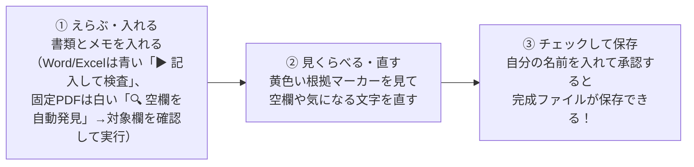
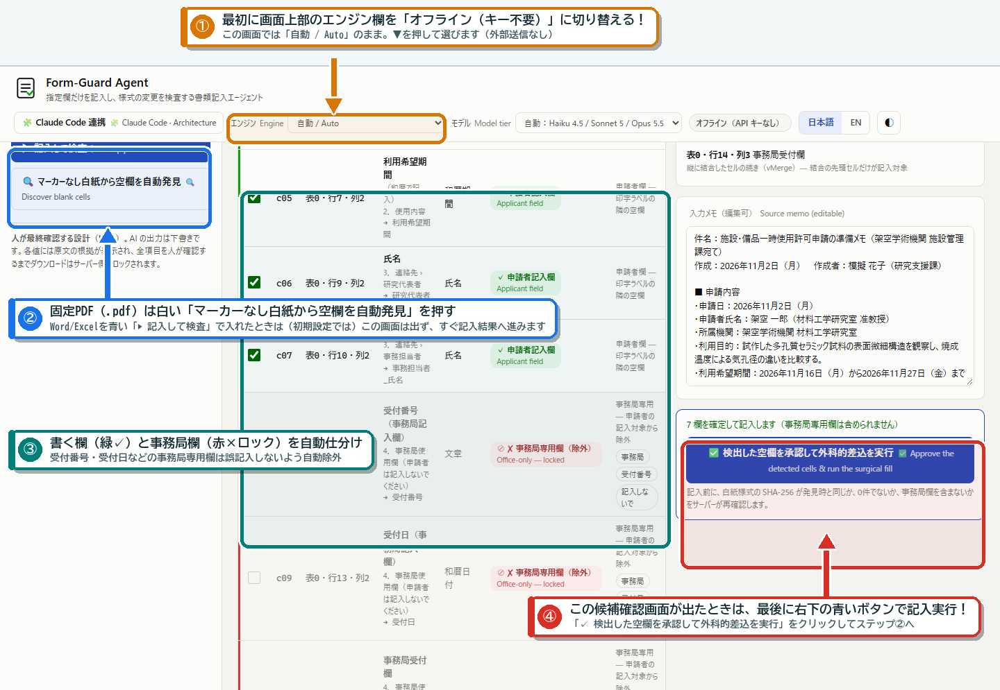
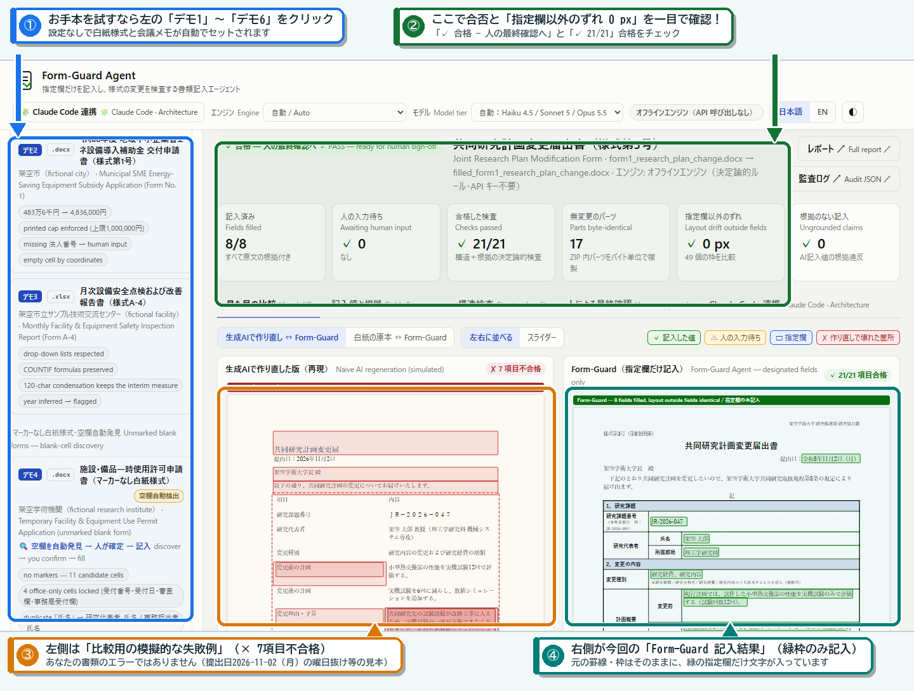
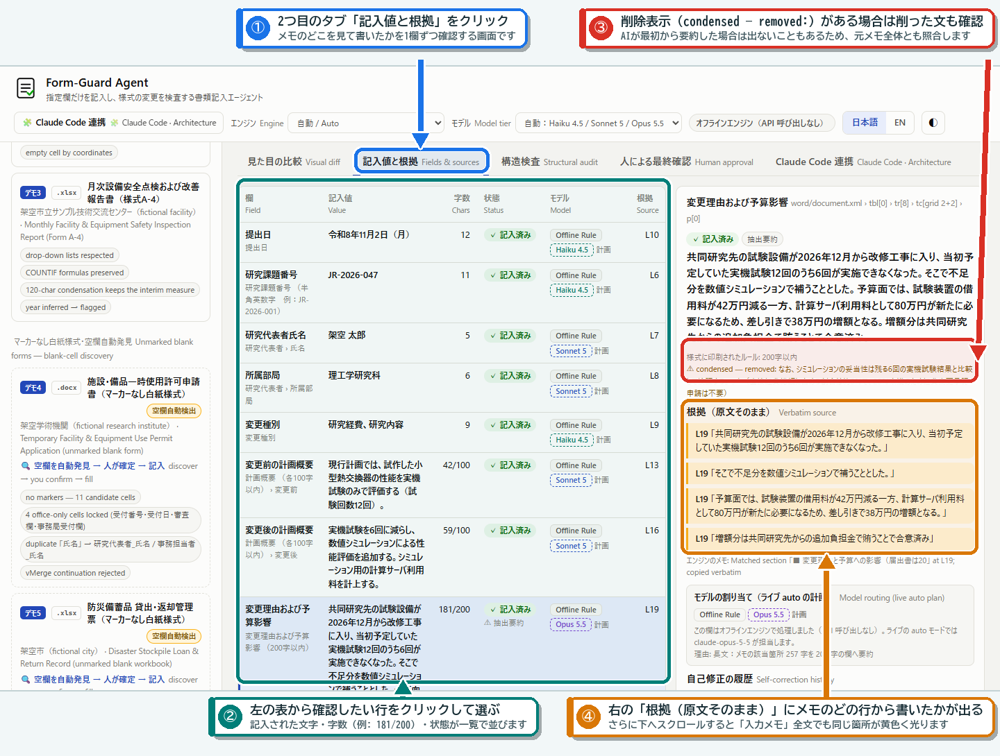
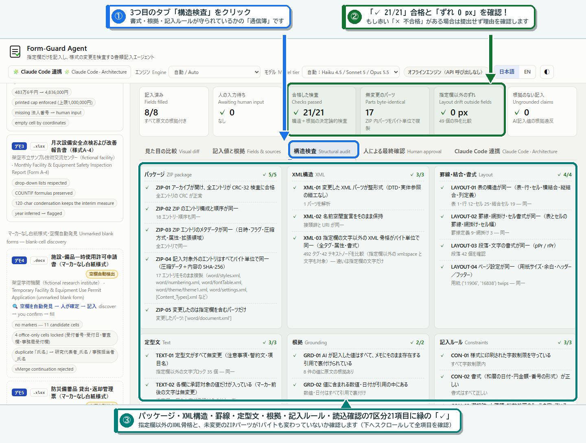
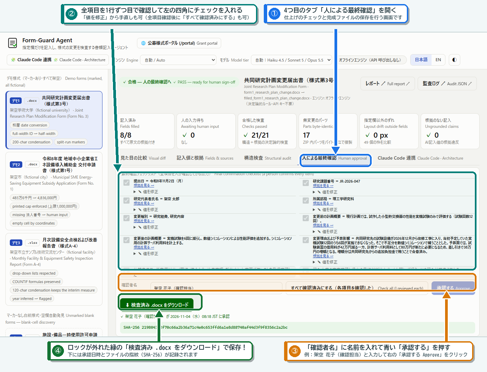

# 🔰 AIが初めてでも3ステップで使える！「Form-Guard Agent」超かんたん説明書（グラフィカル図解版）

作成日：2026-11-05（木）  
対象プロダクト：[Form-Guard Agent](../README.md)（Built with Claude: Japan 2026 提出作品・公式提出締切 `2026-11-08（日）20:00 JST`）

> [!TIP]
> **この説明書のゴール**
> AIやパソコンの専門知識がなくても、**「①えらぶ・入れる → ②見くらべる・直す → ③チェックして保存」の3ステップ**だけで、Word（`.docx`）・Excel（`.xlsx`）・固定PDF（`.pdf`）の指定様式の指定欄だけに記入し、書式の変化を検査して確認できる手順をまとめました。

---

## 💡 そもそも、このアプリは何をしてくれるの？（3行でわかる特徴）

1. **様式の枠や罫線を「壊さない」**：Word・Excel・固定PDFの申請書をAIが一から作り直すのではなく、**「元の用紙はそのままに、指定された空欄にだけ文字を書き込む」**ので、罫線や結合セル、計算式が崩れて差し戻される手戻りを防ぎます。
2. **「どこから書き写したか」を黄色いマーカーで教えてくれる**：あなたが貼り付けたメモの**どの文を見て記入したか**を1つずつ並べて見せてくれます。
3. **わからないことは「勝手に作らず」あなたに聞いてくれる**：メモに書かれていない番号（法人番号など）をAIが勝手に推測して埋めることはありません。空欄のまま残して「ここだけ人が入力してください」と教えてくれます。

---

## 🚪 はじめる前の準備（画面を開く入口）

- この説明は、アプリを導入済みのパソコン向けです。準備担当者が `README.md` の「すぐ試す（APIキー不要）」に沿ってサーバーを起動したあと、ブラウザで **`http://127.0.0.1:8000/`** を開いてください（画面が出ない場合は、準備担当者に起動を依頼してください）。
- 画面右上の言語切り替えが **「日本語」** になっていることを確かめてください（「EN」だと表示が英語になります）。
- 画面上部の **「🔰 使い方（3ステップ）」** ボタンを押すと、いつでも画面上でこの3ステップと用語集を開けます。
- **最初のお試しでは、画面上部の「エンジン」を「オフライン（キー不要）」に切り替えてください。**（「自動 / Auto」は、パソコンにAPIキーが設定済みなら外部AI［Anthropicのサーバー］を使います。本物の個人情報や機密情報は、お試しでも本番でも入れないでください）。

---

## 🪜 使い方は「たった3ステップ」だけ！

※所要時間は、書類の内容・実行モード（オフライン／ライブ Claude）・人が確認する項目の量によって変わります。急がず1つずつ確認してください。

### ステップ①：書類とメモを入れてボタンを押す

画面の左側（メニュー欄）で、やりたいことに合わせて次のボタンを押します。

| やりたいこと | 画面のどこを押す？ | どうなる？ |
| :--- | :--- | :--- |
| **まずはお手本（デモ）を動かしてみたい** | 左メニューの **「デモ1」〜「デモ6」** のどれか1つをクリック | 白紙の申請書と会議メモが自動でセットされ、処理後に記入結果（デモ1〜3）または記入前の空欄確認画面（デモ4〜6）が表示されます（設定やAPIキーは不要です）。 |
| **自分の Word（`.docx`）・Excel（`.xlsx`）の書類に記入したい** | 左メニュー下の **「自分の様式で試す」** に白紙ファイルを選び、下の **「入力メモ」** に会議メモやメール文を貼り付けて、青い **「▶ 記入して検査」** ボタンをクリック | 空欄を見つけて記入し、すぐ**ステップ②（記入結果の確認画面）**へ進みます。 ※**「ゼロ設定の自動適応モード（空欄自動検出＋はみ出し文字数の自動引き締め）」**にチェックが入っていれば、事前の欄設定なしで書く欄の自動選択から文字数調整まで自動で行います（自動で選ばれた欄が正しいか、ステップ②・③で必ず確認してください）。 |
| **自分の固定 PDF（`.pdf`）の書類に記入したい** | 左メニュー下の **「自分の様式で試す」** にPDFファイルと **「入力メモ」** を入れ、白い **「🔍 マーカーなし白紙から空欄を自動発見」** ボタンをクリック | 下の画面ガイドA（「④ 人の確定待ち」画面）が開くので、欄の位置・項目名・記入対象が正しいことを確認して、右下の青い **「✅ 検出した空欄を承認して外科的差込を実行」** ボタンを押します（※自動適応モードは固定PDFでは未検証のため、PDFはこの手順で進めます）。 |

> [!NOTE]
> **「マーカーなし白紙様式（デモ4・デモ5）」や「固定PDF様式（デモ6・自分のPDF）」を選んだときは？**  
> 「④ 人の確定待ち（4段階・白紙空欄の自動検出結果）」という一覧画面（下の**画面ガイドA**）が出ます。あなたが書く欄（申請者欄）には最初からチェックが入っており、役所や事務局が書く欄（受付番号・審査欄・決裁印など）は間違って書かないようロックされて選べません。なお、この画面の下に出るプレビュー（自動プレビュー）は見本なのでそのままでは承認できません。**選択された欄が正しいことを確認して**、右下の青い **「✅ 検出した空欄を承認して外科的差込を実行」** ボタンを押すと、本番の確認画面（ステップ②）へ進めます（デモ1〜3や、Word/Excelで青い「▶ 記入して検査」を押したときは、初期設定ではこの画面は出ず、すぐステップ②へ進みます）。

#### 📸 画面ガイドA（空欄の自動発見）：デモ4〜6や「🔍 空欄を自動発見」を使うときは候補を確認して④を押します（Word/Excelの青い「▶ 記入して検査」で結果が出た場合は、そのままステップ②へ進みます）

- **① オフライン切替**：最初に画面上部のエンジン欄を「オフライン（キー不要）」に切り替える（図では「自動 / Auto」のままなので▼を押して変更）
- **② 入口の分岐**：固定PDFは白い「🔍 空欄を自動発見」を押す（Word/Excelの青い「▶ 記入して検査」では初期設定でこの確認画面は出ず、すぐステップ②へ進みます）
- **③ 自動仕分け確認**：あなたが書く欄（緑✓）と事務局専用欄（赤×ロック）が正しく仕分けられているか確認
- **④ 候補承認して実行（この画面が出た場合のみ）**：右下の青い「✅ 検出した空欄を承認して外科的差込を実行」をクリックしてステップ②へ

---

### ステップ②：記入された内容と「黄色の根拠」を見くらべる

処理が終わると、画面の真ん中に5つのタブ（切り替えボタン）が出ます。普段の書類作成では、左から4つを順番に見ていくだけで確認できます（5つ目の「Claude Code 連携」はAIの仕組みを見たい人向けの画面です）。

| タブの名前 | ここで確認すること（AIに不慣れでも見る場所はここだけ！） |
| :--- | :--- |
| **① 見た目の比較** | **「罫線や枠が崩れていないか」**をパッと見ます。 緑色の枠が今回書き込んだ場所です。上部の **「白紙の原本 ↔ Form-Guard」** や **「スライダー」** ボタンを押すと、左右に動かして見くらべられます。 ※お手本（デモ1〜3）を開いたとき、左側に赤い「×」がたくさん出ますが、これは「比較用に作った模擬的な失敗例（提出日 2026-11-02（月）の和暦・曜日抜け等の見本）」です。あなたの書類が壊れたわけではありません（右側が今回のForm-Guardの記入結果で、「令和8年11月2日（月）」と正しく入っています。合否・入力待ちは画面上部で確認してください）。 |
| **② 記入値と根拠** | **「メモのどこを見て書いたか」**を確認します。 左の表の行をクリックすると、右側の「根拠（原文そのまま）」欄にメモのどの行（L19等）から抜き出したかが黄色背景で表示され、さらに下へスクロールすると「入力メモ」全文の中でも同じ箇所が**黄色**に光ります。 ・日付の「年」を補った場合は **「年は推定」** と表示されます。 ・文字数制限（200字以内など）に収めるためアプリが文を短くした場合は、右側の詳細欄に **`⚠ condensed — removed:`**（英語の表示）に続けて削った文がそのまま出ます。同じ内容は「人による最終確認」タブのチェックリストにも **「字数制限のため削除した文：「…」」** と日本語で出ます。なお、AI（ライブ Claude）が最初から字数内で要約した場合はこの削除表示が出ないこともあるため、**削除表示の有無にかかわらず、短くなった文章は黄色い引用だけでなく元メモ全体と比べ、大事な条件・対象・日付が残っているか必ず人が確認してください。** ・もし文字を直したいときは、右側の詳細欄の下にある入力欄で打ち直して **「値を保存」** を押せば、すぐに書き直して再検査されます（※「値を保存」すると、それまでのチェックと承認は一度解除されるので、変更内容を含めて確認し直してください）。 |
| **③ 構造検査** | **「書式・根拠・記入ルールが守られているかの通信簿」**です。 画面に表示されたすべての検査（「パッケージ」「XML構造」「罫線・結合・書式」「定型文」「根拠」「記入ルール」「読込確認」の7区分21項目、および描画ズレ・はみ出し検査時の「見た目」）を下までスクロールして確認します。 ・画面上部が **「✓ 合格 — 人の最終確認へ」** なら、ステップ③（最終確認）へ進みます。 ・**「⚠ 人の入力が必要」** なら、ステップ③で未入力の欄を入力して再検査します。 ・**「✗ 不合格 — 使用しないでください」** なら提出せず、赤い不合格項目と理由を確認してください（不合格のままでは承認・ダウンロードできません）。 |
| **④ 人による最終確認** | **ステップ③（最後の仕上げ）**を行う画面です。 |

#### 📸 画面ガイドB：「見た目の比較」タブ（矢印①〜④：左側＝比較用の模擬的な失敗例、右側＝Form-Guardの記入結果）

- **① デモ選択**：左メニューの「デモ1」〜「デモ6」でお手本をワンクリック体験
- **② 合否・ずれ0 px**：上部の「✓ 合格」と「21/21 合格」「指定欄以外のずれ 0 px」を確認
- **③ 左は模擬失敗例**：赤い「× 7項目不合格」は比較用の見本です（図中の提出日欄は `2026年11月2日` で、様式の注意事項「日付は和暦で記入すること」に反して和暦も曜日もない失敗例です。正しくは右側と同じ `令和8年11月2日（月）`）
- **④ 右が今回の記入結果**：罫線・枠はそのままに、緑枠の指定欄だけ「令和8年11月2日（月）」等と正しく記入されています

#### 📸 画面ガイドC：「記入値と根拠」タブ（矢印①〜④：左の行を選ぶと、右の「根拠（原文そのまま）」に引用行が出ます）

- **① タブ切替**：2つ目の「記入値と根拠」タブをクリック
- **② 欄を選ぶ**：左の表から確認したい行をクリック
- **③ 削除表示の確認**：アプリの切り詰めでは `condensed — removed:` に削除文を表示します（AIが最初から要約した場合は表示されないことがあるため、表示の有無にかかわらず元メモ全体と照合してください）
- **④ 原文引用の確認**：右の「根拠（原文そのまま）」にメモのどの行（L19等）から書いたかが黄色背景で出ます（さらに下の「入力メモ」全文でも同じ箇所が黄色く光ります）

#### 📸 画面ガイドD：「構造検査」タブ（矢印①〜③：7区分・21項目の自動チェック通信簿）

- **① タブ切替**：3つ目の「構造検査」タブをクリック
- **② 21/21 合格確認**：全21項目合格と「ずれ 0 px」を確認（赤い「× 不合格」がある場合は提出せず理由を確認）
- **③ 7区分・21項目の内訳チェック**：パッケージ・XML構造・罫線・定型文・根拠・記入ルール・読込確認の7区分・全21項目（下へスクロールして全項目を確認）に緑の「✓」がついているか、指定欄以外のXML骨格と未変更のZIPパーツが1バイトも変わっていないか確認します

---

### ステップ③：チェックを入れて、完成した書類をダウンロードする

このアプリでは、**人間が中身を確認しないまま間違った書類が提出されてしまうのを防ぐため**、最初はダウンロードボタンが **「⬇ 検査済みファイル（ロック中）」** になっており、押せない安全設計になっています。

- **1. 「人による最終確認」タブ**を開きます。
- **2.** もしメモに書いていなかった項目（例：デモ2の「法人番号（13桁）」など）や、アプリの短縮処理で条件の削除などを検知して保留した項目があれば、一番上の **「⚠ N 欄に人の入力が必要です」** という案内ボックスに入力欄が出ます。そこに正しい内容を入力して、青い **「反映して再検査」** ボタンを押します。
- **3.** 下の **「最終確認チェックリスト（全項目を人が確認してから出力）」** を上から1行ずつ見て、各行の左にある四角（`□`）にチェックを入れます（各行の **「✎ 値を修正」** を開けば、その場で文字を直して **「値を保存」** することもできます。なお「値を保存」するとそれまでのチェックと承認は解除されます。**全項目を1行ずつ目で読んで確かめたあとに**、下の **「すべて確認済みにする（各項目を確認した）」** ボタンを押してまとめてチェックを入れることもできます）。
- **4.** 一番下の **「確認者名」** に自分の名前（例：`架空 花子（確認担当）`）を入力し、青い **「承認する」** ボタンを押します（※未入力の欄が残っている場合や、検査が不合格の場合は「承認する」ボタンを押せません）。
- **5.** 緑色の **「⬇ 検査済み .docx をダウンロード」** ボタン（Excel なら `.xlsx`、PDF なら `.pdf` と表示されます）のロックが解除されるので、クリックしてパソコンに保存します。
- **6. 【最後の大事な確認】** 画面のプレビューはアプリ内蔵の簡易表示です。保存したファイルを一度、お使いのパソコンの **Word / Excel / PDFビューアーで実際に開いて**、文字の配置や印刷プレビューに問題がないかを目で見て確かめてから提出してください（また、メモ自体に書かれていた内容が事実かどうかの最終判断も人が行います）。

#### 📸 画面ガイドE：「人による最終確認」タブ（矢印①→④：全項目チェック＋確認者名入力でダウンロード解錠）

- **① タブ切替**：4つ目の「人による最終確認」タブを開く
- **② 全項目チェック**：1行ずつ目で確認して左の四角にチェック（「値を修正」で手直しも可）
- **③ 名前を入れて承認**：「確認者名」に名前を入れて青い「承認する」ボタンをクリック
- **④ 保存・実機確認**：ロックが外れた緑の「⬇ 検査済み .docx をダウンロード」で保存！

---

## 🔄 画面に出てくる「むずかしい言葉」のやさしい言いかえ表

画面やレポートに出てくる専門用語は、次の意味です。

| いまの画面・説明の言葉 | やさしい言いかえ | つまりどういうこと？ |
| :--- | :--- | :--- |
| **外科的差込 / 外科的な書き込み** | **空欄だけピンポイント記入** | 元のファイルの枠や書式は一切触らず、指定した空欄の文字だけを書き換えること |
| **決定論的検査（21項目）** | **21項目の自動チェック（書式・根拠・記入ルール）** | 罫線・結合セル・計算式・定型文が変わっていないか、書いた値がメモの文に裏付けられているか、字数・和暦・上限などを守っているか、を決まったルールで21項目調べること |
| **VIS-01（視覚Diff）** | **見た目のズレ・はみ出し確認** | 記入前と記入後のページを比べて、空欄以外の場所がズレていないか・文字が枠からはみ出していないか確かめること |
| **原文根拠（Grounding）** | **メモの引用もと（黄色マーカー）** | AIが勝手に作った言葉ではなく、あなたのメモのどの文から抜き出したかを示す証拠 |
| **抽出要約（Condensed）** | **言い換えなしの文字数カット** | アプリが原文の一部（補足文など）を削って文字数制限内に短縮すること。大事な条件が消えていないか、削除の妥当性は人が元メモ全体と確認します |
| **要約で条件が欠ける（unsafe_condensation）** | **大事な条件が消えるため自動保留** | アプリの短縮処理で、「ただし〜」「〜を除く」などの登録条件語や曜日などの削除を検知して自動記入を保留した状態 |
| **人の入力待ち（needs_human_input）** | **人の入力待ち（メモに記載なし等）** | メモの中に答えが書いていなかったり、条件確認が必要なため、AIが勝手に推測せずあなたにバトンタッチした項目 |
| **HITL（Human-in-the-Loop）** | **人による最終確認ロック** | 人が目で見てOKを出すまで、完成ファイルをダウンロードできない安全装置 |
| **SHA-256（ハッシュ値）** | **ファイルの指紋（すり替え・変更の検知）** | ファイルの中身から計算する64けたの英数字。1文字でも変わると別の値になるので、「画面で確認して承認したファイル」と「ダウンロードするファイル」が同じものかをサーバーが照らし合わせ、違えばダウンロードさせません（書き換えそのものを防ぐ鍵ではありません） |
| **オフライン（キー不要） / 自動 / ライブ Claude** | **お手本・定型ルールモード（外部送信なし） / 自動切替 / AI本番モード** | 「オフライン（キー不要）」はAPIキーなしでパソコン内だけで動くルール式モード。「ライブ Claude」およびAPIキー設定済みパソコンでの「自動 / Auto」は、Claudeの3種類のAI（Haiku・Sonnet・Opus）へメモ等を送って自由な文章を読み取るモード |

---

## ❓ 困ったときのQ&A（よくある質問）

- **Q1. AIの設定（APIキーなど）がわからないのですが使えますか？**
  - **A.** はい、そのまま使えます！画面上部の「エンジン」を **「オフライン（キー不要）」**（またはAPIキー未設定のパソコンなら **「自動 / Auto」**）にしておけば、設定なしで6種類のお手本デモ（デモ1〜デモ6）も、`項目名：内容` のようなメモからの記入もすべて動きます。自由な長文メールなどからAIで読み取りたいときだけ、AnthropicのAPIキーを設定して「ライブ Claude」を使います（データが外へ送られるかどうかは **Q4** を見てください）。
- **Q2. なぜ最初からファイルをダウンロードできないのですか？（ボタンが「ロック中」で押せません）**
  - **A.** AIの書き間違いや、メモにない空欄を見落としたまま提出してしまう事故を防ぐためです。「人による最終確認」タブで未入力の欄があれば埋めて **「反映して再検査」** を押し、チェックリストをすべてチェックして確認者名を入れ **「承認する」** を押すと、緑色のダウンロードボタンが押せるようになります。なお、**未入力の欄がなくても、構造検査や見た目検査が「✗ 不合格」になっている場合は承認できません。**「構造検査」タブで不合格の理由を確認して値を修正・再検査し、解消できない場合はそのファイルの利用を止めて準備担当者に相談してください。
- **Q3. どんなファイルでも使えますか？**
  - **A.** Word（`.docx`）・Excel（`.xlsx`）・固定PDF（`.pdf`）に対応しています。**Web画面から入れられるのは1ファイル15 MBまで（Word・Excel・PDF共通）**です。ただし、**PDFは使えるものが限られます**。WordやAcrobatで「PDFとして保存」したPDFの多くは対象外です（文字の埋め込み方式 `Identity-H` のため）。また、紙をスキャンしただけの画像PDF、パスワード付きのファイル、新しい保存形式（PDF 1.5の圧縮された相互参照）のPDF、ページが回転・切り抜きされたPDF、旧形式の `.doc` / `.xls` も使えません。こうしたファイルは書き込む前に止まり、エラーが出るか「空欄の候補が0件」と表示されます（元の様式は書き換えません）。**PDFで止まったときは、元のWord・Excelファイルがあればそちらで試してください。**
- **Q4. 本物の個人情報や患者情報、社外の機密データを入れてもいいですか？**
  - **A.** **入れないでください（お試しでも本番でも同じです）。** このアプリの画面はあなたのパソコンの中（`127.0.0.1`）で動きますが、画面上部の「エンジン」が最初から選ばれている **「自動 / Auto」のままでも、APIキーが設定されているパソコンでは自動で外部AI（Claude）を使い、入力メモや欄の情報が Anthropic のサーバーへ送信されます**（「ライブ Claude」を選んだときも同じです）。なお、上部の **「オフラインエンジン（API 呼び出しなし）」という表示は現在の記入処理についての表示であり、先に行った空欄発見や過去の処理の送信履歴までは示しません。** 外部送信せずに試す場合は、空欄発見を含む最初の操作より前に必ず **「オフライン（キー不要）」** を選び、途中で切り替えずに実行してください。
- **Q5. 「値を保存」を押したときに `exceeds maximum length` と表示されたらどうすればいいですか？**
  - **A.** 様式に印刷された字数制限（または文字が枠からはみ出さないよう自動適応モードで引き締められた字数上限）を超えています。入力欄の横に表示されている字数（例：`180/180` などの上限字数）以内に文章を短くしてから、もう一度 **「値を保存」** を押してください。
